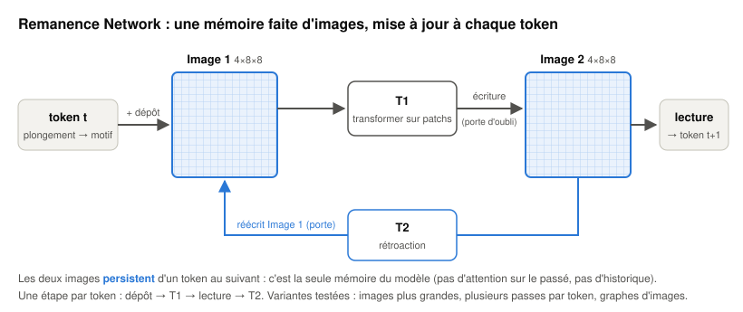
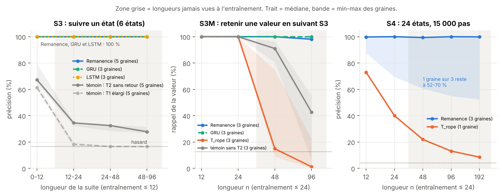
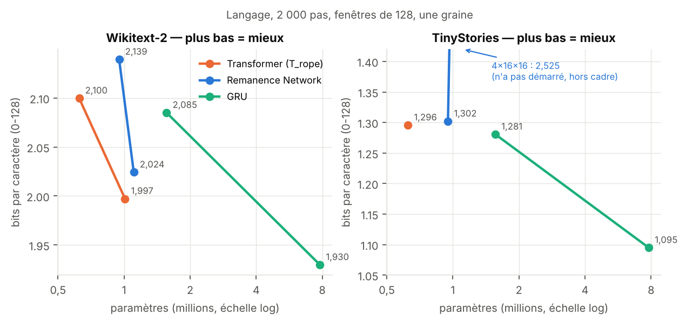
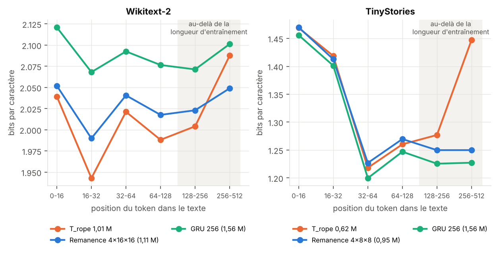
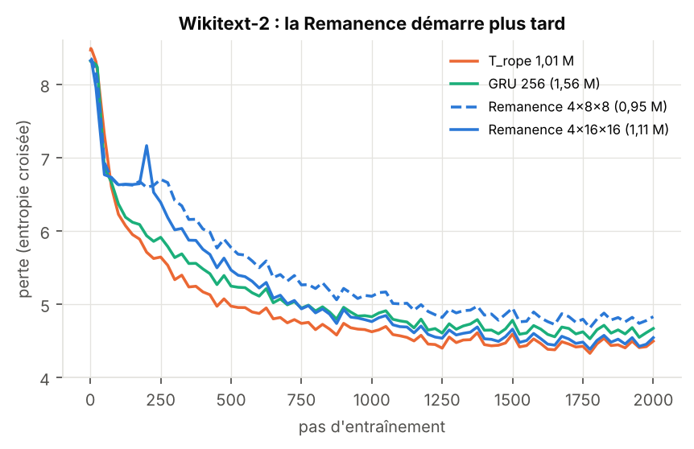
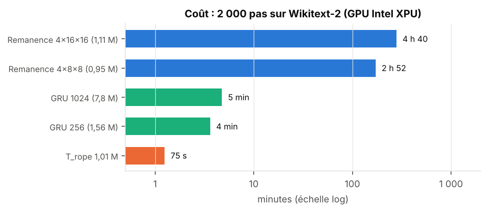
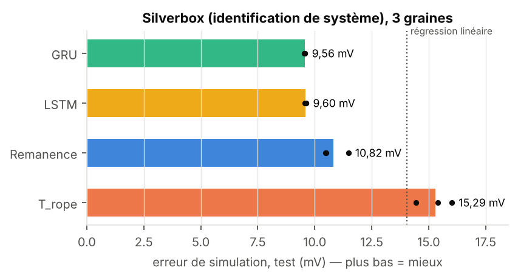
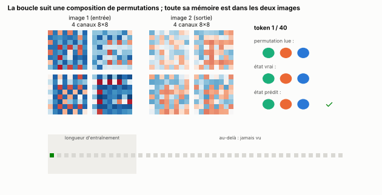

[Version française](README.md)

# Anendophasia Remanence Network

[](.github/workflows/tests.yml)

Can a language model keep its memory as images rather than as words?
*Anendophasia* is the absence of an inner voice: some people think without talking to themselves. This project tests the equivalent idea for a neural network: a transformer whose entire memory fits in two small images, rewritten at every token. Personal research project (November 2026), closed. Every result is pre-registered: criteria and forecasts written before the measurement, failures reported as such.



## Verdict

| question | answer | strength |
|---|---|---|
| Does the remanence give a transformer a **state**? | **Yes.** S3 at 100% up to 8 to 10× the training length; controls with equal parameter count fail. | 5 seeds out of 5 |
| Does it retain information for a long time? | **Yes.** A value kept over 96 tokens while tracking S3 (recall 98 to 100%). | 3 seeds out of 3 |
| Does it do **better than a GRU or an LSTM**? | **No.** They do as well on S3, S3M and pointers, better on Silverbox, and train 12 to 50× faster. | 3 seeds |
| On **language**, does it beat a transformer of the same size? | **No.** 1.3% gap on Wikitext-2 within the training length (2.024 versus 1.997 bits per character). | 1 seed |
| Beyond the training length? | **It stays stable**; the transformer degrades by 3 to 14% depending on the corpus. A GRU stays stable too. | 1 seed, several corpora |
| Does a larger image help? | **Not reproducibly**: −5% on Wikitext-2, fails to start on TinyStories. | 1 seed |
| Compute cost | **8× (CPU) to 220× (GPU)** a transformer of the same size: sequential loop, token by token. | measured |

In other words, the remanence gives a transformer what a recurrent network already has, a memory that passes from one token to the next, but no better than a GRU and much more slowly. A memory *in images* brings no measurable advantage at this scale (≤ 8 M parameters).

## Key results

### 1. Tracking a state: the remanence succeeds where the transformer fails, like a GRU



S3: composing permutations of 3 elements. S3M: S3 plus a value to retain. S4: 24 states. The transformer (T_rope) collapses as soon as the training length is exceeded; the remanence holds. Controls with equal parameter count (widened T1, or T2 that does not write to the input image) fail: it is indeed the T2 → image 1 feedback that creates the state. But GRU and LSTM do as well, in 30 s instead of 11 min. On S4, one seed out of three does not learn in 15,000 steps.

### 2. Language: at equal parameters, on par with the transformer, behind the GRU



2,000 steps, windows of 128 tokens, BPE of 4,096 tokens. On Wikitext-2, the 1.01 M-parameter transformer (1.997 bpc) and the 4×16×16 remanence with 1.11 M (2.024) are within 1.3% of each other. The GRU improves the most when scaled up. On TinyStories, the large image never leaves its initial plateau.



The only clear advantage of the remanence over the transformer lies beyond the training length (grey zone): T_rope degrades, the remanence does not. But the GRU does not degrade either.

### 3. It learns later and costs much more





On language, the remanence stays on a plateau (loss ≈ 6.6) for 200 to 400 steps before dropping; on state tasks too, it drops later than the GRU. Its computation is sequential (two transformers per token, no parallelism over the sequence): 2 h 52 to 4 h 40 for 2,000 steps, versus 75 s for the transformer.

### 4. Silverbox (nonlinear physical system)



Simulation error, 3 seeds: GRU 9.56 mV, LSTM 9.60, remanence 10.82, transformer 15.29. The remanence is competitive, 13% behind the recurrent networks.

## What the images look like



The images are not readable by eye. The state of S3 and the value of S3M can nevertheless be read from them linearly (probes at 94-100%), but they are spread over the whole image, with no dedicated zone.

## What did not work or was not settled

- Variants with no gain: two input images ("double loop"), layered 2-3-1 image network (does not start), alternating training, several T1/T2 passes per token (as in Ouro / Huginn). Pre-trained ViT for T1/T2: inconclusive.
- S5 (120 states): learned by no model, GRU included, in 8,000 steps.
- Limits: ≤ 8 M parameters, short budgets (≤ 15,000 steps), often a single seed on language, untuned learning rate (a sweep shows that 2e-3 helps all models without changing the gap).
- Not done: PG-19 (very long memory), transformer + remanence hybrid, transformer trained on long windows.

Details, numbers and sources: [docs/RESULTS.en.md](docs/RESULTS.en.md).

## Method

Each experiment is an *amendment* to [docs/preenregistrements/PROTOCOLE.md](docs/preenregistrements/PROTOCOLE.md) (in French; 46 amendments): question, setup, numerical criteria and forecasts in %, written and pushed before the measurement, then the results, failures included. Reviews made after the fact are flagged as such.

## Repository layout

```
README.md                  this summary (French; README.en.md = English)
docs/RESULTATS.md          all results, by question, with numbers and sources (RESULTS.en.md = English)
docs/REPRODUIRE.md         commands to redo each result (REPRODUCE.en.md = English)
docs/preenregistrements/   the 46 pre-registrations and their raw results
figures/                   summary figures (scripts/figures_bilan.py); historique/ = figures of the stage reports
src/                       models (s4_loop.py = Remanence Network) and tasks
scripts/                   training and analysis (index: scripts/README.en.md)
results/                   raw results (JSON), read by the figures
notebooks/                 suite_colab.ipynb (GPU); historique/ = notebooks of the stages
archive/                   stage reports 0 to 14 and dead ends, as written during the project
tests/                     pytest: models, tasks, figures re-read from results/
```

In the code, the remanence is called `L_loop` / `L_loop1` ("loop") or `R_CxHxW` (image size); `T_rope` = transformer with rotary positions; `T_dxL` = T_rope of width d and L layers.

```bash
pip install -r requirements.txt
pytest -q                               # 35 tests, ~10 s
python scripts/figures_bilan.py         # regenerates this README's figures
python scripts/cpu_boucle.py L_loop 0   # S3 on CPU, ~11 min
```
