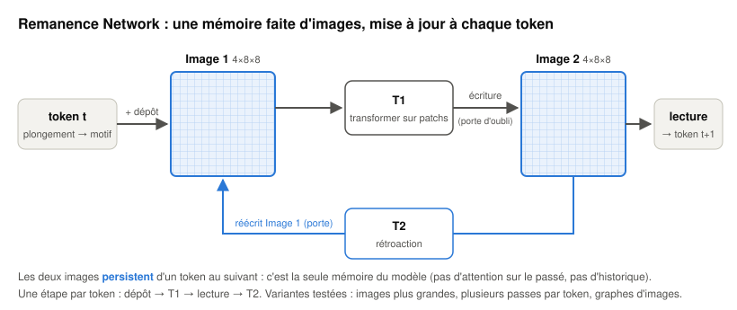
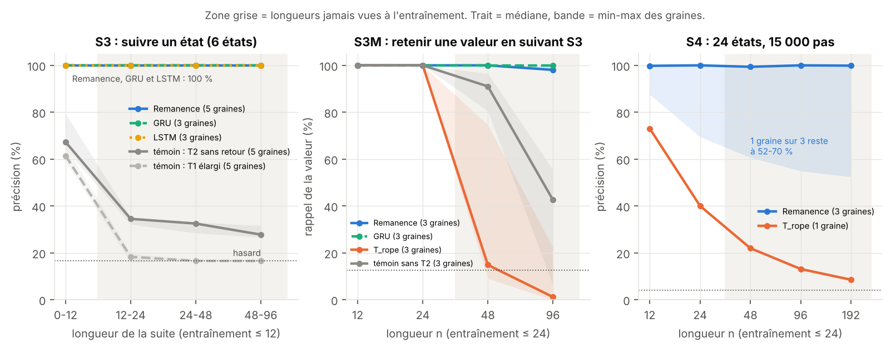
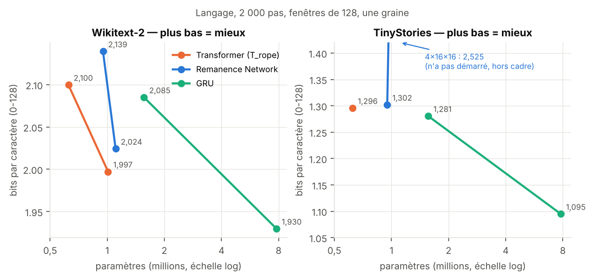
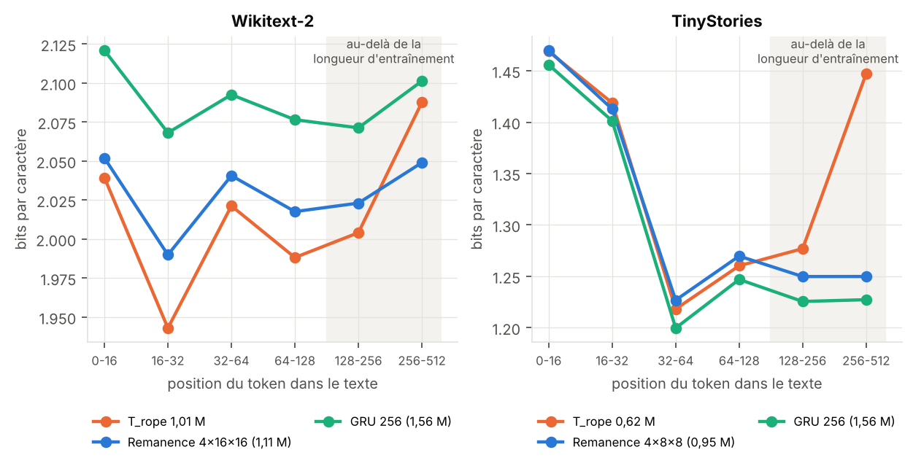
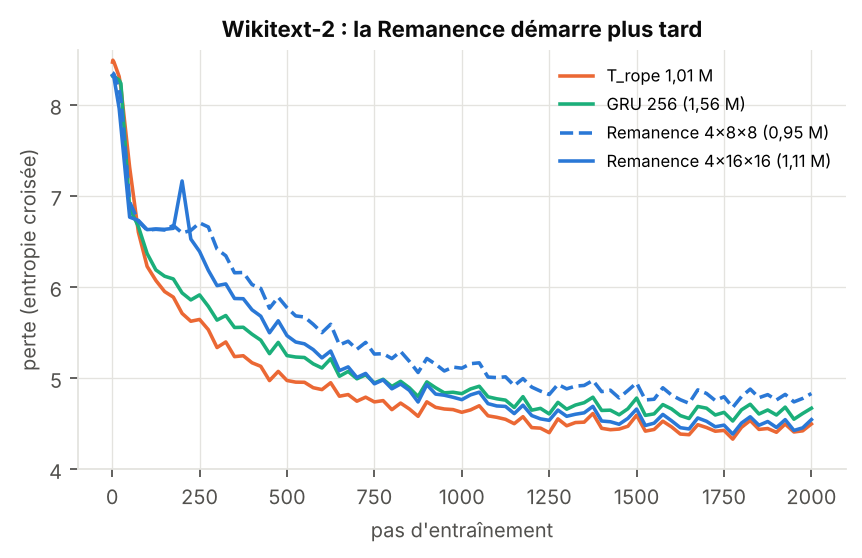
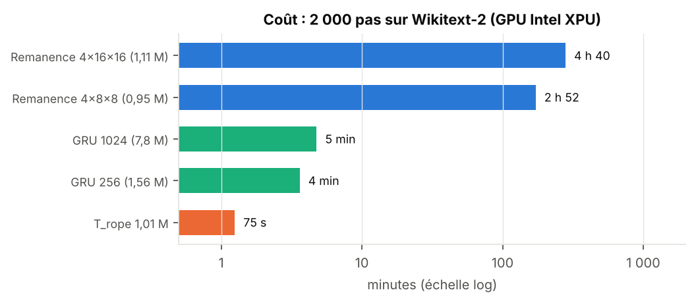
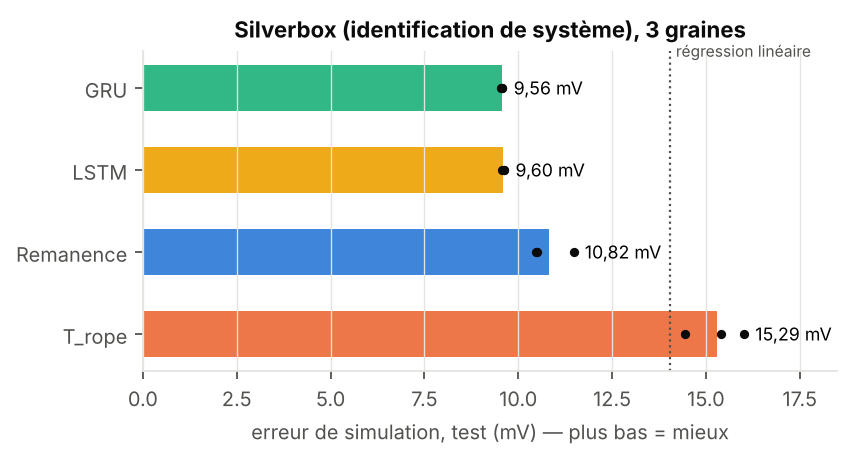
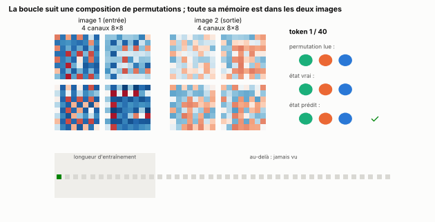

# Anendophasia Remanence Network

[](.github/workflows/tests.yml)

[English version](README.en.md)

Un modèle de langage peut-il garder sa mémoire sous forme d'images plutôt que de mots ?
L'*anendophasie* est l'absence de voix intérieure : certaines personnes pensent sans se parler. Ce projet teste l'idée équivalente pour un réseau de neurones : un transformer dont toute la mémoire tient dans deux petites images, réécrites à chaque token. Projet de recherche personnel (novembre 2026), clos. Chaque résultat est pré-enregistré : critères et pronostics écrits avant la mesure, échecs rapportés comme tels.



## Verdict

| question | réponse | solidité |
|---|---|---|
| La rémanence donne-t-elle un **état** à un transformer ? | **Oui.** S3 à 100 % jusqu'à 8 à 10× la longueur d'entraînement ; les témoins à nombre de paramètres égal échouent. | 5 graines sur 5 |
| Retient-elle une information longtemps ? | **Oui.** Une valeur gardée sur 96 tokens tout en suivant S3 (rappel 98 à 100 %). | 3 graines sur 3 |
| Fait-elle **mieux qu'un GRU ou un LSTM** ? | **Non.** Ils font aussi bien sur S3, S3M et les pointeurs, mieux sur Silverbox, et s'entraînent 12 à 50× plus vite. | 3 graines |
| Sur du **langage**, bat-elle un transformer de même taille ? | **Non.** Écart de 1,3 % sur Wikitext-2 dans la longueur d'entraînement (2,024 contre 1,997 bits par caractère). | 1 graine |
| Au-delà de la longueur d'entraînement ? | **Elle reste stable** ; le transformer se dégrade de 3 à 14 % selon le corpus. Un GRU reste stable aussi. | 1 graine, plusieurs corpus |
| Une image plus grande aide-t-elle ? | **Pas de façon reproductible** : −5 % sur Wikitext-2, ne démarre pas sur TinyStories. | 1 graine |
| Coût de calcul | **8× (CPU) à 220× (GPU)** un transformer de même taille : boucle séquentielle, token par token. | mesuré |

Autrement dit, la rémanence rend à un transformer ce qu'un réseau récurrent a déjà, une mémoire qui passe d'un token au suivant, mais pas mieux qu'un GRU et beaucoup plus lentement. Une mémoire *en images* n'apporte pas d'avantage mesurable à cette échelle (≤ 8 M de paramètres).

## Résultats clés

### 1. Suivre un état : la rémanence réussit là où le transformer échoue, comme un GRU



S3 : composer des permutations de 3 éléments. S3M : S3 plus une valeur à retenir. S4 : 24 états. Le transformer (T_rope) s'effondre dès qu'on dépasse la longueur d'entraînement ; la rémanence tient. Les témoins à nombre de paramètres égal (T1 élargi, ou T2 qui n'écrit pas vers l'image d'entrée) échouent : c'est bien la rétroaction T2 → image 1 qui crée l'état. Mais GRU et LSTM font aussi bien, en 30 s au lieu de 11 min. Sur S4, une graine sur trois n'apprend pas en 15 000 pas.

### 2. Langage : à paramètres égaux, au niveau du transformer, derrière le GRU



2 000 pas, fenêtres de 128 tokens, BPE de 4 096 tokens. Sur Wikitext-2, le transformer de 1,01 M de paramètres (1,997 bpc) et la rémanence 4×16×16 de 1,11 M (2,024) sont à 1,3 % l'un de l'autre. C'est le GRU qui progresse le plus quand on l'agrandit. Sur TinyStories, la grande image ne quitte jamais son plateau de départ.



Le seul avantage net de la rémanence sur le transformer se situe au-delà de la longueur d'entraînement (zone grise) : T_rope se dégrade, la rémanence non. Mais le GRU ne se dégrade pas non plus.

### 3. Elle apprend plus tard et coûte beaucoup plus cher





Sur le langage, la rémanence reste sur un plateau (perte ≈ 6,6) pendant 200 à 400 pas avant de décrocher ; sur les tâches à état aussi, elle décroche plus tard que le GRU. Son calcul est séquentiel (deux transformers par token, sans parallélisme sur la séquence) : 2 h 52 à 4 h 40 pour 2 000 pas, contre 75 s pour le transformer.

### 4. Silverbox (système physique non linéaire)



Erreur de simulation, 3 graines : GRU 9,56 mV, LSTM 9,60, rémanence 10,82, transformer 15,29. La rémanence est compétitive, 13 % derrière les réseaux récurrents.

## À quoi ressemblent les images



Les images ne sont pas lisibles à l'œil. L'état de S3 et la valeur de S3M y sont pourtant lisibles linéairement (sondes à 94-100 %), mais répartis dans toute l'image, sans zone dédiée.

## Ce qui n'a pas marché ou n'a pas été tranché

- Variantes sans gain : deux images d'entrée (« double loop »), réseau d'images en couches 2-3-1 (ne démarre pas), entraînement alterné, plusieurs passes T1/T2 par token (à la Ouro / Huginn). ViT pré-entraîné pour T1/T2 : non concluant.
- S5 (120 états) : appris par aucun modèle, GRU compris, en 8 000 pas.
- Limites : ≤ 8 M de paramètres, budgets courts (≤ 15 000 pas), souvent une seule graine sur le langage, learning rate non réglé (un balayage montre que 2e-3 aide tous les modèles sans changer l'écart).
- Pas fait : PG-19 (mémoire très longue), hybride transformer + rémanence, transformer entraîné sur des fenêtres longues.

Détail, chiffres et sources : [docs/RESULTATS.md](docs/RESULTATS.md).

## Méthode

Chaque expérience est un *amendement* de [docs/preenregistrements/PROTOCOLE.md](docs/preenregistrements/PROTOCOLE.md) (46 amendements) : question, montage, critères chiffrés et pronostics en %, écrits et poussés avant la mesure, puis les résultats, ratés compris. Les relectures faites après coup sont signalées comme telles.

## Organisation du dépôt

```
README.md                  ce résumé
docs/RESULTATS.md          tous les résultats, par question, avec chiffres et sources
docs/REPRODUIRE.md         commandes pour refaire chaque résultat
docs/preenregistrements/   les 46 pré-enregistrements et leurs résultats bruts
figures/                   figures du résumé (scripts/figures_bilan.py) ; historique/ = figures des rapports d'étape
src/                       modèles (s4_loop.py = Remanence Network) et tâches
scripts/                   entraînements et analyses (index : scripts/README.md)
results/                   résultats bruts (JSON), lus par les figures
notebooks/                 suite_colab.ipynb (GPU) ; historique/ = notebooks des étapes
archive/                   rapports d'étape 0 à 14 et fausses pistes, tels qu'écrits pendant le projet
tests/                     pytest : modèles, tâches, figures relues depuis results/
```

Dans le code, la rémanence s'appelle `L_loop` / `L_loop1` (« boucle ») ou `R_CxHxW` (taille d'image) ; `T_rope` = transformer à positions rotatives ; `T_dxL` = T_rope de largeur d et L couches.

```bash
pip install -r requirements.txt
pytest -q                               # 35 tests, ~10 s
python scripts/figures_bilan.py         # refait les figures de ce README
python scripts/cpu_boucle.py L_loop 0   # S3 sur CPU, ~11 min
```
