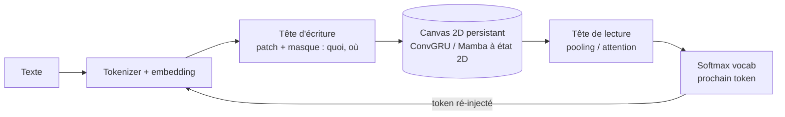

# 1 — Vision du projet

> Tout ce qui a été pensé et dit avant tout code. Ce document fige l'état de la discussion (novembre 2026) : l'origine, la science derrière, les variantes, les choix d'architecture et leurs raisons, le plan d'expérience. Les documents suivants (2_, 3_…) détailleront chaque étape quand elles seront lancées.

## 1. Genèse

Question de départ : existe-t-il des LLM qui transforment le texte en image avant de le traiter, comme les gens qui pensent sans parler dans leur tête ?

Réponse rapide : oui en partie (« thinking with images », chaînes de pensée visuelles), mais toujours comme **outil** au sein d'un raisonnement qui reste verbal. La version extrême — un modèle qui raisonnerait *uniquement* dans un espace visuel ou continu, sans jamais verbaliser, comme une personne sans voix intérieure — n'existe pas encore à l'état de modèle général. Ce projet attaque ce point précis.

## 2. La science cognitive derrière : l'anendophasie

- **Anendophasie** : absence de voix intérieure (terme de Nedergård & Lupyan, 2024). L'expérience de la parole intérieure varie de « presque constante » à « inexistante ». Les gens sans monologue intérieur réussissent moins bien les tâches qui manipulent les mots eux-mêmes (rimer, mémoire verbale), mais normalement partout ailleurs : une différence de **format**, pas de capacité. Nuance : Andreas Lind (2025) argue que les données montrent des gens qui *rapportent* peu de voix intérieure, pas une absence prouvée.
- **La surprise : « pas verbal » ≠ « en images »**. Avec l'échantillonnage de l'expérience (Hurlburt), une grande partie des pensées sans monologue n'est **ni verbale ni visuelle** : la *pensée non symbolisée* (unsymbolized thinking), explicite et différenciée mais sans mots, sans images, sans aucun symbole. Pensée « pure », sans format.
- **Les axes sont indépendants** : anendophasie (pas de voix intérieure), aphantasia (pas d'imagerie visuelle), anauralia (pas de sons mentaux) se combinent librement. Seuls ~26 % des aphantasiques n'ont aucune imagerie dans aucun sens.
- **Mais quand il y a imagerie, elle est continue** : la querelle Kosslyn vs Pylyshyn. Format *dépeigneur* (l'image mentale préserve la structure spatiale de façon quasi-analogique : rotation mentale, balayage, distances ; active les aires rétinotopiques) contre format *propositionnel* (sous l'image, une description discrète). Pôles de structure : la pensée verbale est **discrète, sérielle, compositionnelle** ; l'imagerie est **continue, parallèle, spatiale**.

**Table de correspondance humain ↔ ML :**

| Pensée humaine | Analogue ML |
|:---|:---|
| Monologue intérieur : discret, sériel, verbal | Chaîne de tokens de CoT, un mot après l'autre |
| Imagerie dépeignante : continue, spatiale, parallèle | Canvas 2D récurrent (ce projet, V3/V4) |
| Pensée non symbolisée : sans format | Raisonnement latent continu (COCONUT et successeurs, V5) |

## 3. État de l'art ML

Ce qui existe déjà :

- **Thinking with images** en production : OpenAI o3/o4-mini intègrent des images dans leur chaîne de raisonnement (crop, zoom, rotation outillés), mais le squelette du raisonnement reste textuel.
- **Anole / Thinking with Generated Images** : le modèle génère des images intermédiaires (sous-objectifs visuels), les critique, poursuit. Chaîne multimodale entrelacée — mais la partie verbale reste le squelette, la génération d'image est une étape dans une chaîne textuelle.
- **CoVT / Latent Visual Reasoning** : chaînes de pensée sur tokens visuels continus, ou raisonnement dans l'espace latent — greffés sur des modèles qui verbalisent aussi.
- **Pixel-based LMs** (PIXEL, puis « Enhancing Robustness… via Pixel-based Approach ») : le texte est rendu à l'écran (image du texte) voire **chaque mot rendu comme une image individuelle** qui remplace l'embedding textuel — mais but précis (robustesse orthographique), transformation = rendu, pas d'apprentissage de la forme, dos classique.
- **COCONUT** : preuve de principe clé — un LLM qui raisonne en latents continus au lieu de verbaliser chaque étape (discrétisation perdante à chaque token) résout mieux certains problèmes de planification. **La discrétisation verbale intermédiaire est un goulot.**

Ce qui n'existe pas (le slot visé) : transformation mot→image **apprise**, texte traité comme **vidéo** (frame par token), dos **CNN 3D ou modèle vidéo** — et surtout : un modèle dont **l'état est une image persistante** mise à jour token après token, sans verbalisation. Les vision-Mambas (VMamba, LocalMamba, QuadMamba, Mamba2D, Spatial-Mamba) traitent tous l'*entrée* par des scans d'image ; **l'état caché reste un vecteur plat**. Le slot « état d'espace = carte spatiale 2D » semble ouvert.

## 4. Pourquoi l'image par mot seule ne suffit pas

Une transformation mot→image apprise, c'est mathématiquement **une couche d'embedding déguisée** (mot → tenseur H×L). L'espace pixel n'apporte que des priors : structure 2D locale, équivariance par translation des convolutions, résolution fixe, (bornitude). Ces priors ne sont ni bons ni mauvais a priori — la question est de savoir si le gradient les exploite. Et le Conv/CNN 3D qui lirait cette « vidéo » : un noyau temporel de taille k ne mélange que k tokens consécutifs ; empiler L couches donne un champ réceptif ~L(k−1)+1 tokens. Pour une anaphore à 50 mots, il faut beaucoup de couches ou de la dilatation causale : on retombe sur les conv LM de 2015-2017, battus par le transformer pour les dépendances longues.

## 5. Pourquoi le CNN 3D triche sur ce signal

Une vraie vidéo a des frames consécutives quasi identiques (physique, mouvement continu) : le CNN 3D exploite cette redondance. Ici, deux frames consécutives = deux mots consécutifs (« le » et « chat » n'ont aucune raison de donner des images voisines). Les statistiques de la dimension temporelle sont celles du langage, pas de la physique. **La continuité ne vaut quelque chose que si le dos a un prior de localité** (conv ou attention locale) : un transformer à attention globale s'en fiche, il saute où il veut. Donc « comment rendre l'image continue » et « quel dos » doivent être décidés ensemble.

## 6. Les deux façons de rendre l'image continue

### V2 — Interpolation (module de transition)

Entre l'image du token t et celle du token t+1, un module appris insère des frames intermédiaires.

- **L'actif caché** : si le module est un vrai réseau (pas une interpolation linéaire), **le chemin choisi de A à B porte de l'information**. Où la trajectoire passe dans le plan, à quelle vitesse, en contournant quoi : ça peut encoder la *relation* entre deux mots consécutifs, information absente des endpoints seuls. La syntaxe devient de la géométrie du mouvement — exactement ce que les CNN vidéo sont faits pour lire (vecteurs de mouvement).
- **Les risques** : dégénérescence vers des trajectoires rectilignes triviales (même écueil que les modèles de flow) ; coût compute ×k (k frames intermédiaires).

### V3 — Accumulation (canvas récurrent)

La frame ne représente plus « le mot » mais « le texte compris jusqu'ici ». La continuité n'est pas fabriquée, elle est **causale** : le canvas change peu d'une étape à l'autre parce qu'il s'enrichit d'un petit incrément, comme un dessin au crayon qui se construit. C'est la plus proche de l'imagerie dépeignante.

- **Précédent exact** : DRAW (DeepMind, 2015) génère des images en écrivant itérativement des patchs sur un canvas persistant via des têtes d'écriture attentionnelles, avec effacement/réécriture. Ce projet = **DRAW inversé** : au lieu de lire un canvas pour le remplir, on lit des mots pour le remplir.
- **Le risque classique** : l'écrasement (un mot fort qui écrase ce qui était déjà écrit). Réponses : gating (écrire quoi, où, écraser quoi), updates résiduelles, contrainte de norme des incrément.

**Les deux ne s'excluent pas** : le canvas de V3 donne les états, le module de V2 les transitions — une trajectoire continue d'un état mental qui s'accumule, la pensée comme vidéo au sens propre.

## 7. Le vrai débat de dos : ConvRNN vs Mamba/SSD

La question « ConvGRU ou Mamba » est mal posée. Le bon découpage n'est pas la famille d'architecture mais **le format de l'état** :

- **ConvGRU** : état spatial (une carte inspectable à chaque token) + gates classiques + transitions **non linéaires**. Riche, mais rétrograde côté entraînement : BPTT séquentiel, coûteux sur séquences longues. Famille que les modèles d'état d'espace ont dépassée à l'échelle sur le langage.
- **Mamba (plat)** : gates sélectives modernes (portes d'entrée/sortie dépendantes de l'input — le même rôle que les gates LSTM/GRU) + entraînement parallèle (parallel scan). Mais **état plat** : l'utiliser tel quel détruit le canvas, donc l'objet même de l'étude.

Le point de théorie : un ConvRNN à mise à jour linéaire **est** un SSM dont l'état est une image (S4 = récurrence vue comme convolution infinie ; sélectivité de Mamba = gates). La dualité SSD (Mamba-2) montre que ces récurrences linéaires sont le miroir de l'attention : un canvas linéaire et un transformer sont deux faces d'une même matrice. Le **slot ouvert** : gates sélectives à la Mamba écrivant dans un **état 2D** — le « canvas-Mamba » (V4). Si la mise à jour reste linéaire en l'état (conv sans non-linéarité sur l'état lui-même), le parallel scan s'applique et l'entraînement redevient parallélisable ; si on met des non-linéarités dans la transition d'état, on retombe côté ConvGRU et son entraînement lent.

### L'échelon intermédiaire : V0, le canvas 1D

Avant de payer le 2D, une ablation : l'état est une **bande 1D** (un vecteur de longueur N avec de la géométrie : un ordre, des voisins), mise à jour token après token.

- **Ce qui ne serait PAS un canvas** : un état 1D adressé par contenu sans interactions locales, c'est une bande NTM/DNC (mémoire externe adressée, terrain cartographié 2014-2016) ; un état 1D sans adressage, c'est le hidden state d'un RNN ; des slots mis à jour par attention, c'est le Relational Memory Core (2018). Ce qui fait le canvas, c'est l'élément non négociable : **des interactions locales entre positions voisines** (conv le long de la bande), qui donnent à la position un sens géométrique. Sans ça, V0 ne teste rien de nouveau.
- **Ce que le 1D peut tester** : la version faible de l'hypothèse — le gradient apprend-il à écrire les mots *à des positions structurées* (mots proches en sens écrits à des positions voisines) ? Sur une ligne, une seule dimension de variation sémantique peut s'organiser proprement (un gradient sémantique le long de la bande).
- **Ce que le 1D ne peut pas tester** : la topologie d'une ligne est pauvre (deux voisins, une direction) ; un plan donne deux axes indépendants + des quartiers. Si le 1D organise un gradient sémantique et que le 2D organise plus, la valeur de la 2ᵉ dimension est **mesurée**, pas supposée.
- **Bonus d'analyse** : la « vidéo » d'un canvas 1D se lit comme un **spectrogramme / piano-roll** (position × temps) : on voit en clair où chaque token écrit, quand une zone est réécrite, écrasée, ou laissée vivre.
- **Écho maison** : un canvas 1D à écritures apprises, c'est une **ligne à retard apprise** — le pendant de delay-tensor-esn, où les retards sont *conçus*.

## 8. Le pipeline retenu (spécification V3)

Détails :

- **Pas d'image par token** : dans la version accumulation, on ne matérialise jamais une image par mot ; la transformation mot→image apprise vit entièrement dans la tête d'écriture.
- **Deux découpages possibles de l'écriture** : (a) fusionné — la cellule ConvGRU prend (embedding du token, canvas précédent) et rend le nouveau canvas ; (b) séparé, façon DRAW — une tête produit (patch, masque) = *quoi* et *où* écrire, puis la cellule intègre : canvas ← (1−z)·canvas + z·patch masqué. Le découpage (b) coûte plus de paramètres mais le masque est **inspectable** : on voit où chaque mot écrit.
- **Lecture à chaque token, pas à la fin** : pooling conv ou attention sur le canvas → vecteur → softmax vocab. Le modèle est autoregressif : il émet un mot, le ré-injecte dans sa propre entrée, continue. La même boucle qu'une chaîne de pensée textuelle, sauf que l'état qui la porte est une image.
- **Le canvas est une seule image qui évolue**, pas une pile de frames. La « vidéo » des états successifs est un enregistrement précieux pour l'analyse post-hoc, mais le modèle n'a besoin que de h_t.
- **Tout est différentiable de bout en bout** : entraînement simple par cross-entropie sur le token suivant.
- **Contrainte d'inspectabilité** : borner le canvas (sigmoid/tanh) pour qu'il reste dans [0,1] et reste *regardable* comme une image — sinon on perd le critère d'inspection qui justifie tout l'exercice.

## 9. Auditabilité

Argument industriel contre : une chaîne de pensée textuelle, on peut la lire, la filtrer en RLHF, la surveiller pour la sécurité, la distiller. Un canvas visuel serait bien plus difficile à auditer — un vrai frein, pas seulement un choix technique.

Argument retourné : si le canvas s'organise sémantiquement, il devient lui-même un outil d'interprétabilité (on regarde littéralement à quoi le modèle pense), et la « vidéo » des états donne un film du raisonnement lisible par des humains.

## 10. Plan d'expérience et critères GO/NO-GO

Échelle des essais (petite échelle, corpus TinyStories, budget CPU) :

1. **Canvas 1D (V0)** : le premier échelon — mesure ce que la 2ᵉ dimension ajoute (voir §7). S'il matche déjà le 2D, la planéité ne vaut rien et le projet pivote vers « mémoire externe apprise », terrain NTM/DNC.
2. **ConvGRU petit** (V3) : le plus simple, état inspectable à chaque token, BPTT supportable sur quelques centaines de tokens. Référence minimale.
3. **Mamba plat à budget égal** : le témoin qui isole l'hypothèse — s'il matche le canvas, la structure spatiale de l'état n'apporte rien et l'idée est morte dans sa version forte.
4. **Canvas-Mamba sélectif** (V4) : le pari, avec parallel scan si les updates restent linéaires. Le seul des trois qui n'existe pas dans la littérature, le seul où une victoire vaut un papier.

Critères GO : perplexité comparable aux baselines **et** canvas visiblement structuré (géométrie sémantique dans l'espace 2D, masques d'écriture interprétables). NO-GO consigné avec la même rigueur qu'un succès.

## 11. Questions ouvertes

- La gradient organise-t-il l'espace 2D sémantiquement, ou le canvas reste-t-il une soupe ?
- Combien de résolution H×L faut-il — trop petit, pas de place pour la géométrie ; trop grand, le coût d'écriture explose ?
- Faut-il une non-linéarité dans la transition d'état (richesse) ou rester linéaire (parallel scan) — et où mettre la non-linéarité si on reste scannable ?
- Que modélise la trajectoire entre états (V2) : syntaxe, topic, quoi ?
- Le canvas survit-il aux longues séquences (dégradation récurrente) sans attention globale ?
- Que reste-t-il du 2D quand le 1D est déjà là : la planéité apporte-t-elle de la place sémantique, ou seulement du coût ?

## 12. Références

**Science cognitive :**
- Nedergård & Lupyan, *Not Everybody Has an Inner Voice: Behavioral Consequences of Anendophasia* (2024) : https://journals.sagepub.com/doi/10.1177/09567976241243004
- Lind, *Are There Really People With No Inner Voice? Commentary on Nedergaard and Lupyan (2024)* : https://journals.sagepub.com/doi/10.1177/09567976251335583
- Hurlburt & Akhter, *Unsymbolized thinking* : https://www.sciencedirect.com/science/article/abs/pii/S1053810008000524
- Le débat de l'imagerie (Kosslyn vs Pylyshyn) : https://en.wikipedia.org/wiki/Imagery_debate
- Anauralia et ses liens avec l'aphantasia : https://aphantasie.org/en/info/anauralia

**ML, thinking with images :**
- OpenAI, *Thinking with images* (o3/o4-mini) : https://openai.com/index/thinking-with-images/
- Chern et al., *Thinking with Generated Images* (Anole) : https://arxiv.org/html/2505.22525v1
- *Thinking with Images for Multimodal Reasoning: Foundations, Methods, and Future Frontiers* (survey) : https://arxiv.org/html/2506.23918v3
- Awesome Think With Images (liste de papiers) : https://github.com/zhaochen0110/Awesome_Think_With_Images
- *Chain-of-Visual-Thought: Teaching VLMs to See and Think Better with Continuous Visual Tokens* : https://arxiv.org/html/2511.19418v1
- *Latent Visual Reasoning* : https://arxiv.org/html/2509.24251v2

**ML, texte en pixels / latents :**
- *Language Modelling with Pixels* (PIXEL) : https://arxiv.org/html/2207.06991v2
- *Enhancing Robustness of Autoregressive Language Models against Orthographic Attacks via Pixel-based Approach* (mot → image) : https://arxiv.org/html/2508.21206
- *Leveraging Visual Tokens for Extended Text Contexts in Multi-Modal Learning* (NeurIPS 2024) : https://proceedings.neurips.cc/paper_files/paper/2024/file/19f10adb6749b0c9f1ff7610bd01d44d-Paper-Conference.pdf
- COCONUT (chaîne de pensée latente continue, Meta) : https://arxiv.org/abs/2412.06769

**ML, architectures à état :**
- VMamba (NeurIPS 2024) : https://proceedings.neurips.cc/paper_files/paper/2024/file/baa2da9ae4bfed26520bb61d259a3653-Paper-Conference.pdf
- Mamba2D : https://arxiv.org/html/2412.16146
- Spatial-Mamba (ICLR 2025) : https://proceedings.iclr.cc/paper_files/paper/2025/file/b7216f4a324864e1f592c18de4d83d10-Paper-Conference.pdf
- LocalMamba : https://arxiv.org/html/2403.09338v1
- DRAW : A Recurrent Neural Network For Image Generation (DeepMind, 2015) : https://arxiv.org/abs/1502.04544
- SSD / Mamba-2, *Transformers are SSMs* : https://arxiv.org/abs/2405.21060
- Neural Turing Machines (Graves et al., 2014) : https://arxiv.org/abs/1410.5401
- DNC, *Hybrid computing using a neural network with dynamic external memory* (Nature, 2016) : https://www.nature.com/articles/nature16961
- Relational Memory Core (2018) : https://arxiv.org/abs/1806.01865
- delay-tensor-esn (précédent maison : retards *conçus* ; le canvas 1D, des retards *appris*) : https://github.com/mathisfrinzi/delay-tensor-esn

## 13. Statut

💭 Vision en discussion (novembre 2026). Prochaine étape si lancée : prototype minimal V3 sur TinyStories, à budget égal contre Mamba plat et petit transformer.
