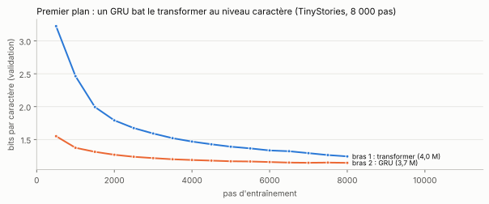
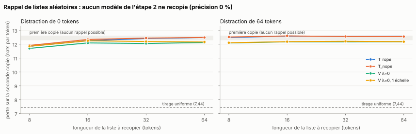

[Sommaire des rapports](../rapport/README.md)

# Fausses pistes

Ce qui n'a rien donné, ce qui a été abandonné, et pourquoi. Gardé ici pour ne pas le refaire.

## Le premier plan : sept bras au niveau caractère

Le plan initial ([archives/PLANING_canvas.md](../rapport/archives/PLANING_canvas.md), [archives/2_protocole_canvas.md](../rapport/archives/2_protocole_canvas.md)) comparait sept « bras » au niveau caractère : transformer, GRU, SSM plat, canvas 1D, canvas 2D, vidéo littérale. Deux ont tourné jusqu'au bout :

| bras | paramètres | bits par caractère |
|---|---|---|
| 1. transformer | 4,0 M | 1,24 |
| 2. GRU | 3,7 M | 1,14 |

Les canvas 1D et 2D ont fini leur entraînement à 1,81 et 1,92 bpc, loin derrière, et leurs analyses de structure ont planté. **Ce qui a changé ensuite** : les canvas perdaient nettement contre les deux références, et le plan posait trop de questions à la fois. Le projet a été repris par le bas, une question par étape (la partie 1 : le texte tient-il dans une image ?), avec des tokens BPE à partir de la partie 2.

## Rappel de listes aléatoires (amendement 8)

Test exploratoire de la partie 2 : une liste de n tokens aléatoires, une distraction de d tokens, puis la même liste ; le modèle doit-il prédire la seconde copie mieux que la première ?

**Aucun modèle ne recopie** (précision 0 % partout, perte de la seconde copie à peine sous celle de la première). Ces modèles, entraînés sur des histoires, n'ont jamais vu de copie : le test mesurait l'apprentissage en contexte d'une tâche absente de l'entraînement, pas la mémoire. À refaire avec une tâche de copie dans les données ; c'est le rappel clé-valeur de l'étape 5.

## Histoires synthétiques, version 1

Le générateur tronquait toutes les histoires d'un lot à la plus courte : les questions finales disparaissaient, et les modèles apprenaient seulement le début des histoires. Résultats supprimés, bug corrigé, version 2 pré-enregistrée (amendement 19b) avant d'être lancée. La version 2 est dans la [partie 6](../rapport/6_langage.md).

## L'image qui évolue seule (modèle D, amendement 9)

Idée : le token dépose une tache sans lire l'image, puis l'image « se prépare » au token suivant par 1 ou 2 pas d'évolution autonome. Résultat : l'évolution libre n'aide pas, elle dégrade même l'extrapolation (1,327 bpc à 512–1 024 avec un pas, 0,998 sans). Sur le suivi d'état, D ne fait pas mieux que les transformers. Ce qui compte est que l'écriture **lise** l'image (V), puis qu'un réseau **renvoie** de l'information vers l'entrée (la boucle).

## Une continuité qui rendrait l'image compacte ou robuste

Hypothèses de la partie 2 : une vidéo continue (λ > 0) serait plus robuste au bruit, et son information tiendrait dans quelques directions. Les deux sont contredites ([partie 7](../rapport/7_analyses.md)) : plus sensible au bruit, et une information dans des directions de faible variance.

## S5

Aucun modèle n'apprend S5 (120 états), même dans la longueur d'entraînement (5 à 9 % pour 0,8 % de hasard, 8 000 pas). La boucle n'a pas encore été essayée sur S5 : c'est dans l'étape 5, en attente.

## Temps de réflexion sur une permutation (amendement 21)

Premier test de l'idée « raisonner en laissant tourner la boucle » : k jetons de pause avant de répondre à une poursuite de pointeurs (6 paires d'une permutation, puis « où arrive-t-on depuis x en h sauts ? »). **Aucun modèle n'apprend**, pas même le saut simple, et la boucle reste au hasard partout. Pire, la tâche avait un raccourci : sur une permutation de 6 symboles, h sauts ramènent sur x avec probabilité 17, 33, 33, 50, 33 et 67 % pour h = 1 à 6, et le transformer comme le témoin sans boucle ont appris exactement cela (« répondre x »). Erreur de conception, consignée telle quelle dans le protocole. À refaire avec une fonction aléatoire sur plus de symboles, en vérifiant d'abord qu'un transformer apprend la tâche.

## bAbI et ListOps sur CPU (amendements 24 et 25)

Deux tâches classiques essayées avec ~100 k paramètres et 4 000 pas. bAbI (tâches 1, 2, 3, 6) : `T_rope` plafonne à ~50 % sur la tâche 1, soit à peine plus que le raccourci « dernier lieu cité » (52,7 %). ListOps (MAX/MIN/MED/SUM mod 10, profondeur 1 à 5) : `T_rope` 80 / 52 / 39 / 36 / 34 %, `L_loop1` 80 / 54 / 39 / 41 / 39 %, seuils d'étape 0 non atteints. Dans les deux cas l'expérience s'est arrêtée à l'étape 0 comme prévu, sans conclure sur la boucle : c'est le budget qui limite, pas (démontrablement) l'architecture. Détails : partie 10.
