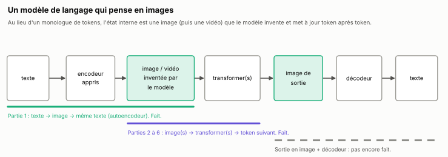
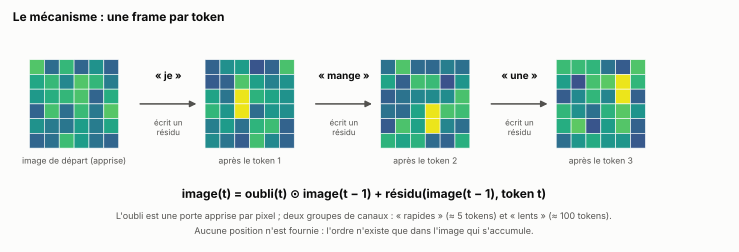
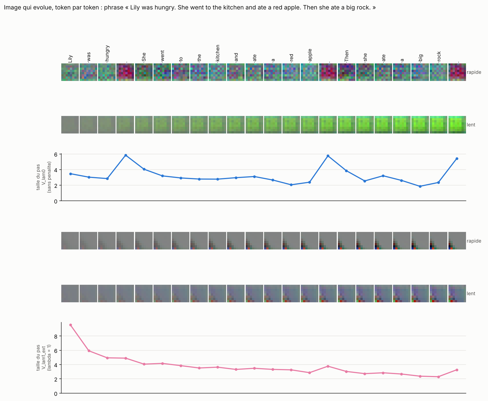
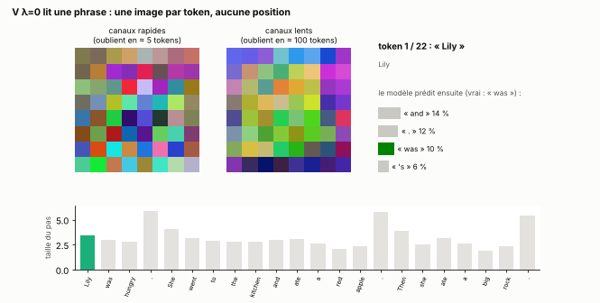

[Sommaire](README.md) · [Partie 1 →](1_autoencodeur.md)

# Partie 0 — L'idée, le mécanisme, le protocole



> **Ce qu'il faut retenir**
>
> - Certaines personnes pensent sans voix intérieure (*anendophasie*, Nedergård et Lupyan, 2024). Les modèles de langage, eux, « pensent » par une chaîne de tokens. Ce projet demande ce que devient un modèle dont l'état interne est une **image qui évolue**, pas un monologue.
> - Le mécanisme est le même partout : à chaque token, l'image est multipliée par une **porte d'oubli** apprise puis reçoit un **résidu**. Aucune position n'est donnée au modèle : l'ordre n'existe que dans l'image qui s'accumule.
> - On garde les transformers ; on change ce qui circule entre eux.
> - Chaque expérience a été **pré-enregistrée** (question, modèles, critères) avant la première mesure, dans [PROTOCOLE.md](../../docs/preenregistrements/PROTOCOLE.md). Les verdicts du rapport sont lus contre ces critères, y compris quand ils déçoivent.

## 0.1 D'où vient l'idée

La discussion de départ est archivée telle quelle dans [archives/1_vision_projet.md](archives/1_vision_projet.md). En résumé :

- **Le constat cognitif.** L'expérience de la parole intérieure va de « presque constante » à « absente ». Les gens qui rapportent peu de voix intérieure réussissent moins bien les tâches qui manipulent les mots eux-mêmes (rimes, mémoire verbale), et normalement le reste : une différence de **format**, pas de capacité. Mais « pas verbal » ne veut pas dire « en images » : une bonne part de la pensée sans mots n'est ni verbale ni visuelle (pensée non symbolisée, Hurlburt).
- **Le constat ML.** Les modèles qui « pensent avec des images » (o3, Anole, chaînes de pensée visuelles) gardent un squelette verbal ; les modèles qui lisent le texte en pixels (PIXEL) n'ont qu'un état plat derrière. Les modèles qui raisonnent en latents continus (COCONUT) montrent que la discrétisation en tokens est un goulot. La case libre : **un état interne qui soit une carte spatiale 2D**, mise à jour token après token.
- **Ce qu'on ne prétend pas.** Une image par mot n'est qu'un embedding déguisé. Ce qui peut apporter quelque chose, c'est la **dynamique** : une image qui accumule le sens, oublie progressivement, et que d'autres réseaux lisent et corrigent.

## 0.2 Le mécanisme



```
image(t) = oubli(t) ⊙ image(t − 1) + résidu(image(t − 1), token t)
```

- `oubli(t)` est une porte sigmoïde par pixel, calculée à partir de l'image et du token ; `résidu` est borné par tanh.
- Dans les parties 2 et 3, l'image a deux groupes de canaux : **rapides** (rétention initiale 0,8, ≈ 5 tokens de mémoire) et **lents** (0,99, ≈ 100 tokens). La porte reste apprise.
- Une **pénalité de continuité λ** peut forcer deux frames successives à se ressembler : la suite d'images devient alors une vraie vidéo. Indice de continuité = pas moyen entre frames consécutives ÷ distance moyenne entre frames de textes différents (≤ 0,5 : continu).

Voici ce que fait la vidéo d'un modèle entraîné (partie 2) sur une phrase : chaque colonne est l'image après un token, en haut les canaux rapides, en bas les lents ; les courbes donnent la taille de chaque pas. Le point final de chaque phrase provoque un grand saut chez V λ=0 ; avec λ=1 la trajectoire devient régulière.



La même chose, animée, avec ce que le modèle prédit à chaque token (`python scripts/exemple.py phrase "votre phrase"`) :



## 0.3 Les modèles, par leur nom

Les noms reviennent dans toutes les parties. Les couleurs des graphes suivent le modèle, jamais son rang.

| nom | ce que c'est | état interne | parties |
|---|---|---|---|
| `T_rope` | transformer causal avec positions rotatives (référence) | tous les tokens passés | 2, 3, 5, 6 |
| `T_nope` | le même sans aucune position | tous les tokens passés | 2, 3 |
| `V_lam0`, `V_lam1` | vidéo : une frame 6×8×8 par token, lue par un transformer **sans position** ; λ = pénalité de continuité | la suite des frames | 2, 3, 6 |
| `V1_lam0` | vidéo à une seule échelle de temps | la suite des frames | 2 |
| `D_*` | image qui évolue : le token dépose une tache sans lire l'image, puis 0 à 2 pas d'évolution libre | la suite des frames | 2, 3 |
| `L_loop` | **rémanence** : deux images, T1 lit l'image 1 et écrit dans l'image 2, T2 lit l'image 2 et écrit dans l'image 1 | **deux images, rien d'autre** | 3, 4, 5, 6 |
| `L_noloop` | témoin : pas de T2, l'image 1 ne reçoit que les dépôts | deux images | 3, 4, 5 |
| `L_wide`, `L_i2` | témoins à capacité égale à la rémanence (partie 4) | deux images | 4 |

Le suffixe `1` (`L_loop1`, `L_noloop1`) désigne des transformers à une couche, utilisés sur CPU.

## 0.4 Le protocole

- **Pré-enregistrement.** Chaque étape commence par un amendement daté dans [PROTOCOLE.md](../../docs/preenregistrements/PROTOCOLE.md) : question, modèles, budget, critères chiffrés, lecture prévue. Les résultats sont ajoutés en dessous, sans réécrire ce qui précède. Quand un amendement est écrit après une première graine (amendement 15), c'est dit.
- **Graines.** Trois graines par cas sur GPU, cinq pour les contrôles sur CPU. Les graphes montrent chaque graine quand elles divergent : la médiane cache des succès isolés.
- **Budgets.** GPU : Colab T4, modèles de ≈ 6 M paramètres (partie 2) ou ≈ 0,9 M (parties 3 et 4). CPU : modèles de 0,1 à 1 M paramètres, quelques milliers de pas.
- **Ce qui est mesuré.** Fidélité de reconstruction (partie 1), bits par caractère (parties 2 et 6), précision par position et **au-delà de la longueur d'entraînement** (parties 3 à 5). L'extrapolation en longueur est la mesure centrale : un modèle qui a compris la règle doit la suivre plus loin qu'on ne la lui a montrée.

## 0.5 Références

Voir [références](references.md) : Nedergård et Lupyan (2024), Lind (2025), Hurlburt et Akhter (2008), PIXEL (2022), COCONUT (2024), DRAW (2015), Mamba-2 (2024).
