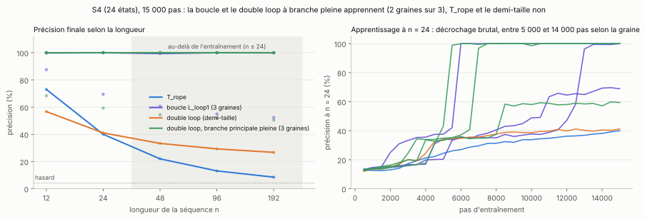

[Sommaire](README.md) · [← Partie 9](9_reflexion.md)

# Partie 10 — Des tâches classiques et un double loop

> **Ce qu'il faut retenir**
>
> - **S4 (24 états) est la meilleure tâche trouvée jusqu'ici pour comparer des variantes** : à 15 000 pas, la boucle `L_loop1` l'apprend à **≈ 100 % jusqu'à n = 192** (8 fois la longueur d'entraînement) sur **2 graines sur 3** (la troisième plafonne à ~52 % à n = 192). `T_rope` (1 graine) plafonne à 40 % à n = 24 et s'effondre au-delà (9 % à n = 192).
> - **Le double loop** (deux images d'entrée de demi-taille, une image de sortie, quatre transformers, mêmes paramètres et même mémoire totale que la boucle) fait **jeu égal avec la boucle sur S3 + mémoire** (rappel 98 % contre 98 % à n = 96) et ses deux read-in se répartissent bien l'information. Sur S4, sa version demi-taille **plafonne à 41 %** (une graine) ; avec une branche principale pleine (la boucle) et une petite branche annexe, il fait **exactement comme la boucle** : 2 graines sur 3 apprennent, la même graine échoue.
> - **Sur d'autres tâches, le double loop fait jeu égal avec la boucle** : S3 avec deux valeurs à retenir (2 graines sur 3 apprennent pour chacun, rappel médian à n = 96 de 95,7 % contre 95,3 %) et liste circulaire de 6 symboles (100 % à 1, 2 et 3 sauts sur 2 graines sur 2, comme la boucle, aucune extrapolation à 4 et 5 sauts). Aucun gain, et il coûte environ deux fois plus cher.
> - **Sur du texte réel (étiquetage grammatical, UD English-EWT)**, les trois modèles sont à 86,4-86,5 % de précision, au niveau d'une simple table de fréquences de mots (86,1 %) : la tâche ne départage rien à ce budget (amendement 35).
> - **Entraîner les images puis les transformers en alternance ne démarre pas plus vite** : sur S4, les trois graines alternées n'atteignent jamais 90 % (21 à 36 % à n = 24), là où l'entraînement simultané réussit 2 fois sur 3 (amendement 45).
> - **bAbI et ListOps n'ont rien montré** : même `T_rope` échoue aux seuils fixés à l'avance (budget CPU de ~100 k paramètres et 4 000 pas), les expériences se sont arrêtées à l'étape 0, comme prévu par le protocole.
> - Tout est pré-enregistré (amendements 24 à 29) ; les chiffres sont dans `PROTOCOLE.md`.

## 10.1 Pourquoi S4

S3 est appris par la boucle (partie 4) et saturé par S3 + mémoire (partie 5) : on ne peut plus rien y comparer. S5 n'est appris par personne (partie 3). S4 (24 permutations, hasard 4,2 %) est entre les deux. À 4 000 pas, aucun modèle ne l'apprend (13 à 19 % à n = 24, amendement 27, tâche non exploitable) ; à **15 000 pas** (amendement 27b), la boucle décroche brutalement vers 5 000–6 000 pas et finit à 100 % partout.

| précision (%), graine 0 | n = 12 | 24 | 48 | 96 | 192 |
|---|---|---|---|---|---|
| T_rope | 73 | 40 | 22 | 13 | 8,5 |
| boucle `L_loop1` | 100 | 100 | 100 | 100 | 100 |
| double loop (demi-taille) | 57 | 41 | 33 | 29 | 27 |

## 10.2 Le double loop (amendements 26 et 27b)

Image1 et Image2 (2×8×8 chacune) reçoivent chaque token par deux read-in distincts ; Image3 (4×8×8) est l'image de sortie ; quatre transformers : 1→3, 2→3, 3→1, 3→2. Mémoire totale 512 valeurs et calcul par token comme la boucle, 3 % de paramètres en moins.

- **S3 + mémoire** : égal à la boucle (rappel à n = 96 : 0,988 / 0,914 / 0,984 contre 0,980 / 1,000 / 0,977), mais cette tâche est saturée. Annuler le dépôt sur Image1 ou sur Image2 coûte ≥ 5 points à chaque fois : les deux read-in servent ; sur 2 graines ils se spécialisent spontanément, l'un portant la valeur à retenir, l'autre l'état de S3, avec des rôles inversés d'une graine à l'autre.
- **S4** : plateau à 41 % (une graine), alors que la boucle atteint 100 %. Deux explications, testées par l'amendement 29 (en cours, voir 10.4) : le budget réparti sur deux demi-branches (dilution), ou la structure à deux entrées elle-même.
- **Prix** : environ deux fois plus lent à entraîner que la boucle (1 210 s contre 667 s sur S3M ; 5 000 s contre 3 150 s sur S4).

## 10.3 bAbI et ListOps (amendements 24 et 25)

Deux tâches classiques, avec un budget CPU minuscule, pour voir si la boucle sort de ses tâches synthétiques.

- **bAbI** (tâches 1, 2, 3, 6) : `T_rope` plafonne à ~50 % sur la tâche 1. Un raccourci (répondre « le dernier lieu cité ») donne déjà 52,7 %. Étape 0 non atteinte, arrêt.
- **ListOps** (expressions imbriquées MAX/MIN/MED/SUM mod 10) : à profondeur 1 à 5, `T_rope` fait 80 / 52 / 39 / 36 / 34 % et `L_loop1` 80 / 54 / 39 / 41 / 39 %. Les seuils (≥ 70 % en profondeur 2, ≥ 45 % en profondeur 3) ne sont pas atteints, arrêt. Pour mémoire, les transformers de la littérature (LRA) sont à ~37 % sur ListOps pleine taille. Le plateau à ~80 % en profondeur 1 est compatible avec SUM mod 10 au hasard ; non testé.

Aucun modèle n'a appris ces tâches : ce n'est pas un résultat sur la boucle, seulement la mesure de ce qu'un budget CPU permet.

## 10.4 Dilution ou perturbation ? (amendement 29)

Le double loop demi-taille plafonnait à 41 % sur S4 (une graine). Deux explications : le budget réparti sur deux demi-branches (**dilution**), ou la structure à deux entrées elle-même (**perturbation**). Test : `L_dloop1_full`, dont la branche principale est exactement la boucle (Image1 4×8×8, transformers à d = 64) plus une branche annexe (Image2 2×8×8, d = 44), 211 688 paramètres au lieu de 154 844.

| S4, 15 000 pas, précision à n = 24 / n = 192 (%) | graine 0 | graine 1 | graine 2 |
|---|---|---|---|
| boucle `L_loop1` | 100 / 100 | 69 / 52 | 100 / 100 |
| double loop, branche principale pleine | 100 / 100 | 59 / 51 | 100 / 100 |
| double loop demi-taille | 41 / 27 | – | – |

- **La branche annexe ne perturbe pas l'apprentissage** : même taux de réussite que la boucle (2 graines sur 3), et la même graine (la 1) échoue pour les deux. La variabilité entre graines est donc une propriété de S4 à ce budget, pas du double loop.
- **Dilution : compatible, non établie.** Le demi-taille a échoué sur la graine 0, que la boucle et le double loop à branche pleine réussissent, mais une graine ne suffit pas. Il faudrait les graines 1 et 2 du demi-taille.
- Le décrochage arrive entre ~5 000 et ~14 000 pas selon la graine : 15 000 pas est un budget juste, les échecs de la graine 1 sont peut-être des apprentissages en retard.

## 10.5 Le double loop sur d'autres tâches (amendement 33)

| tâche | boucle `L_loop1` | double loop `L_dloop1_full` |
|---|---|---|
| S3 + deux valeurs (rappel à n = 96, médiane ; graines qui apprennent) | 95,3 % ; 2/3 | 95,7 % ; 2/3 |
| liste circulaire, 1 à 3 sauts, sans pauses | 100 % sur 2 graines, 20 % sur la 3e (graine 1) | 100 % sur 2 graines sur 2 |
| liste circulaire, 4 et 5 sauts (hors entraînement) | 0 à 4 % | 1 à 3 % |

Sur S3 + deux valeurs, les deux read-in servent (annuler l'un ou l'autre fait chuter S3 et au moins un rappel), mais sans spécialisation nette « une image par valeur » ; les graines qui échouent ne sont pas les mêmes (la boucle ne retient pas bien les deux valeurs sur la graine 2, le double loop n'apprend pas S3 sur la graine 0). Aucune tâche testée jusqu'ici ne montre un avantage du double loop, et il est ≈ 2 fois plus lent à entraîner (1 340–1 390 s contre 750–780 s sur S3 + deux valeurs).

## 10.6 Du texte réel : étiquetage grammatical (amendement 35)

Une tâche « de transformer » sur données réelles : prédire la catégorie grammaticale (17 classes) de chaque mot d'une phrase anglaise du web (UD English-EWT, 204 578 mots d'entraînement), de gauche à droite, avec un vocabulaire fermé de 5 000 mots. 3 graines, 3 000 pas.

| précision dev (%) | graine 0 | graine 1 | graine 2 | moyenne | temps |
|---|---|---|---|---|---|
| table de fréquences (référence) | | | | 86,1 | – |
| `T_rope` | 86,35 | 86,40 | 86,69 | 86,48 | ≈ 70 s |
| boucle `L_loop1` | 86,42 | 86,29 | 86,54 | 86,42 | ≈ 1 350 s |
| double loop `L_dloop1_full` | 86,46 | 86,65 | 86,45 | 86,52 | ≈ 2 530 s |

Aucun modèle ne dépasse la table de fréquences de plus de 0,4 point et les trois sont à 0,1 point les uns des autres. Les pronostics d'un transformer à 91-92 % sont infirmés. Le plafond vient vraisemblablement de la tâche (pas de contexte à droite, mots rares inconnus, pas de traits de caractères) et pas de l'architecture : cette tâche **ne départage pas** les modèles, et la boucle y coûte 20 à 40 fois plus de calcul pour le même résultat.

## 10.7 Entraîner images et transformers en alternance (amendement 45)

Hypothèse de Mathis : les images (écriture et lecture des tokens) et les transformers (dynamique entre images) se gênent en apprenant simultanément, d'où le démarrage tardif sur S4. Test : images seules, puis transformers seuls, par phases de 250 pas pendant les 6 000 premiers pas, puis tout ensemble ; mêmes graines et mêmes lots que l'entraînement simultané (comparaison par paire).

| S4, 15 000 pas, `L_loop1` | graine 0 | graine 1 | graine 2 |
|---|---|---|---|
| simultané : décrochage, précision finale à n = 24 | 6 000 pas, 100 % | jamais, 69 % | 13 000 pas, 100 % |
| alterné : décrochage, précision finale à n = 24 | jamais, 21 % | jamais, 36 % | jamais, 36 % |

L'alterné est **plus lent** (verdict pré-enregistré). Sa précision monte lentement, sans le saut brutal du simultané, et se bloque à 21-36 %. Les deux parties ont donc besoin d'apprendre ensemble. Une seule configuration d'alternance a été essayée (phases de 250 pas, 6 000 pas) ; d'autres rythmes restent à tester. Le temps par pas ne change pas : la lenteur de calcul vient de la boucle séquentielle sur les tokens, pas de l'optimisation.

## 10.8 Limites

Trois graines au plus sur S4 (une seule pour `T_rope` et le double loop demi-taille), donc aucun test statistique ; budget CPU (~100 à 200 k paramètres) ; ListOps et bAbI non concluants ; pas de routeur (la sortie du MLP qui choisit la transformation à appliquer) : il sera pré-enregistré dans un amendement séparé, sur une tâche non saturée pour le modèle testé.

Code : `src/s6_double.py`, `scripts/cpu_double.py`, `scripts/cpu_s4.py`, `scripts/cpu_s3m2.py`, `scripts/reseau_exp.py`, `scripts/cpu_ud.py`, `scripts/cpu_alt.py`, `scripts/cpu_babi.py`, `scripts/cpu_listops.py`. Résultats : `results/dl_S3M_*`, `results/s3m2_*`, `results/s4_*`, `results/reseau_L_dloop1_full_k0_*`, `results/ud_*`, `results/alt_*`, `results/babi_*`, `results/listops_*`. Protocole : amendements 24 à 29, 33, 35 et 45.
