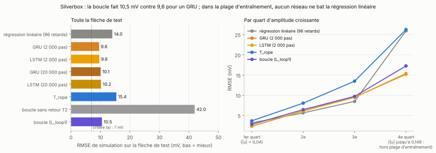

[Sommaire](README.md) · [← Partie 10](10_taches_et_double_loop.md)

# Partie 11 — La rémanence contre un GRU sur des données réelles : Silverbox

> **Ce qu'il faut retenir**
>
> - Sur **Silverbox** (circuit électronique à oscillateur de Duffing, benchmark d'identification non linéaire), la rémanence à une couche fait **10,5 mV** de RMSE de simulation sur la flèche de test, contre **9,6 pour un GRU**, 9,6 pour un LSTM, 15,4 pour T_rope et 14,0 pour une régression linéaire (graine 0 ; moyennes sur 3 graines en 11.4).
> - **Elle est compétitive (à ≈ 10 % du GRU) mais ne le bat pas**, et coûte ≈ 14 fois plus de temps à nombre de pas égal (31 min contre 2,2 min). Le GRU avec 10 fois plus de pas (20 000, ≈ 21 min) ne fait pas mieux (10,1 mV).
> - **Le retour T2 compte** : la même rémanence sans T2 fait 42 mV, bien pire que la régression linéaire.
> - **Mais aucun réseau ne bat la régression linéaire dans la plage d'entraînement** : sur la validation, le linéaire à 96 retards fait 5,5 mV contre 6,5 à 6,9 pour les réseaux. Les gains viennent du dernier quart de la flèche, hors de la plage d'amplitude vue à l'entraînement, où le linéaire s'effondre (26 mV) ; les réseaux aussi, à 15–17 mV. La non-linéarité n'est donc pas vraiment apprise à ce budget.

## 11.1 Montage (amendement 28)

**Données.** `SNLS80mV.csv`, 131 072 échantillons à ≈ 610 Hz, entrée V1 et sortie V2, copie publique (le téléchargement officiel est bloqué depuis le bac à sable). Test : les 40 000 premiers échantillons (entrée « en flèche » d'amplitude croissante, |u| jusqu'à 0,149 contre 0,123 au plus à l'entraînement) ; entraînement : 40 000–121 071 ; validation : les 10 000 suivants.

**Tâche.** *Simulation* : prédire la sortie à partir des seules entrées passées. Fenêtres de 96 pas, 32 d'échauffement de l'état, perte sur les 64 derniers pas. **Les chiffres ne sont pas comparables à ceux publiés pour le benchmark** (de l'ordre du mV ou moins, en simulation complète depuis un état initial connu).

**Modèles** (lot 32, lr 1e-3, 1 graine) : régression linéaire (32 et 96 retards), GRU et LSTM (256 unités, ≈ 200 et 265 k paramètres), T_rope (2 couches, 100 k), rémanence (L_loop1, deux images 4×8×8, 159 k), rémanence sans retour T2 (105 k). 2 000 pas, sauf GRU et LSTM aussi à 20 000.

## 11.2 Résultats

RMSE de simulation (mV, bas = mieux) :

| Modèle | Test (flèche) | Validation | 1er quart / 4e quart du test | Temps |
|---|---|---|---|---|
| constante (moyenne) | 53,0 | – | – | – |
| régression linéaire, 96 retards | 14,0 | **5,5** | 3,2 / 25,9 | – |
| GRU, 2 000 pas | **9,56** | 6,69 | 2,3 / 15,2 | 2,2 min |
| LSTM, 2 000 pas | 9,62 | 6,68 | 2,4 / 15,4 | 1,6 min |
| GRU, 20 000 pas | 10,07 | 6,53 | 2,5 / 16,5 | 21 min |
| LSTM, 20 000 pas | 10,19 | 6,55 | 2,4 / 16,8 | 15 min |
| T_rope | 15,40 | 9,66 | 3,7 / 26,2 | 1,5 min |
| rémanence sans T2 | 41,96 | 33,70 | 12,4 / 62,8 | 17 min |
| **rémanence (L_loop1)** | 10,51 | 6,94 | 2,8 / 17,2 | 31 min |

**Critères pré-enregistrés** : (a) un modèle apprend la non-linéarité (RMSE < 0,5 × le linéaire, soit 7 mV) : **non, aucun**, pas même le GRU ou le LSTM (meilleur : 9,56). (b) la rémanence est compétitive (≤ 1,5 × le meilleur RNN à pas égaux) : **atteint** (10,51 contre un seuil de 14,3). (c) la rémanence bat les RNN : **non**. (d) le retour T2 compte (≤ 0,8 × la rémanence sans T2) : **atteint**, à 25 % de la RMSE du témoin. Pronostics : (a) pour GRU/LSTM (≈ 85 %) **infirmé** ; (b) ≈ 40 %, (c) ≈ 10 %, (d) ≈ 50 % : cohérents avec le résultat.

## 11.3 Lecture prudente

- **Ce que ce test montre** : la rémanence, conçue pour de l'état discret, sait aussi suivre un signal continu à peu près aussi bien qu'un GRU, et le retour T2 est indispensable, comme pour S3 et la liste circulaire. Elle ne dépasse pas un RNN classique, et coûte beaucoup plus cher : sur ce type de données, elle n'a pas de raison pratique d'être préférée.
- **Ce qu'il ne montre pas** : aucun modèle, RNN compris, n'a appris à modéliser l'oscillateur mieux qu'un filtre linéaire dans la plage d'entraînement. L'écart avec la littérature (≈ 1 mV) vient probablement du budget minuscule, des fenêtres de 96 pas (pas d'état initial connu) et d'un réglage minimal (pas de balayage de lr ni de taille). La comparaison reste valable à protocole égal, pas en absolu.
- **Hors plage** : tous les modèles dégradent de la même façon (l'erreur du dernier quart est 6 à 7 fois celle du premier). Rien n'indique que la rémanence extrapole mieux en amplitude.
- **Limites** : une graine ; un système assez lisse ; les écarts de 5 à 10 % entre GRU, LSTM et rémanence sont à la limite de ce qu'une graine permet d'affirmer ; paramètres de 100 à 265 k seulement approximativement égaux.

Code : `scripts/silverbox.py`. Résultats : `results/silverbox_*`. Protocole : amendement 28.

## 11.4 Trois graines (amendement 30)

RMSE de test (mV), graines 0, 1, 2 : GRU 9,56 / 9,58 / 9,53 (moyenne **9,56**, écart-type 0,02) ; LSTM 9,60 ± 0,03 ; rémanence 10,51 / 11,47 / 10,48 (moyenne **10,82** ± 0,56) ; T_rope 15,29 ± 0,79. Validation (moyenne) : GRU 6,68, LSTM 6,67, rémanence 7,06, T_rope 9,38. L'écart GRU-boucle (1,26 mV) dépasse le plus grand écart-type (0,56) : **critère atteint**, pronostic 60 %. La rémanence reste donc bien derrière le GRU et le LSTM, d'environ 13 %, sur cette tâche. Le linéaire (déterministe) reste à 14,0 en test et 5,5 en validation.
