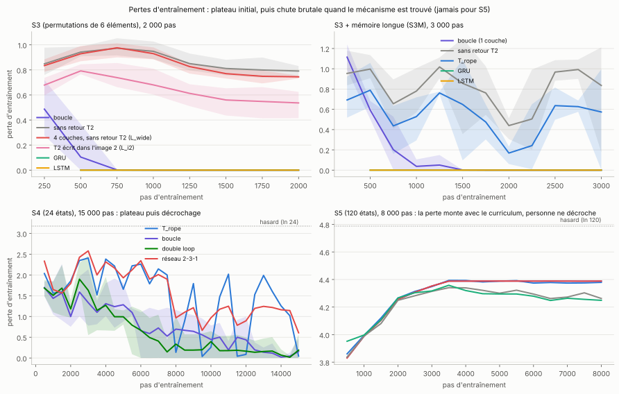
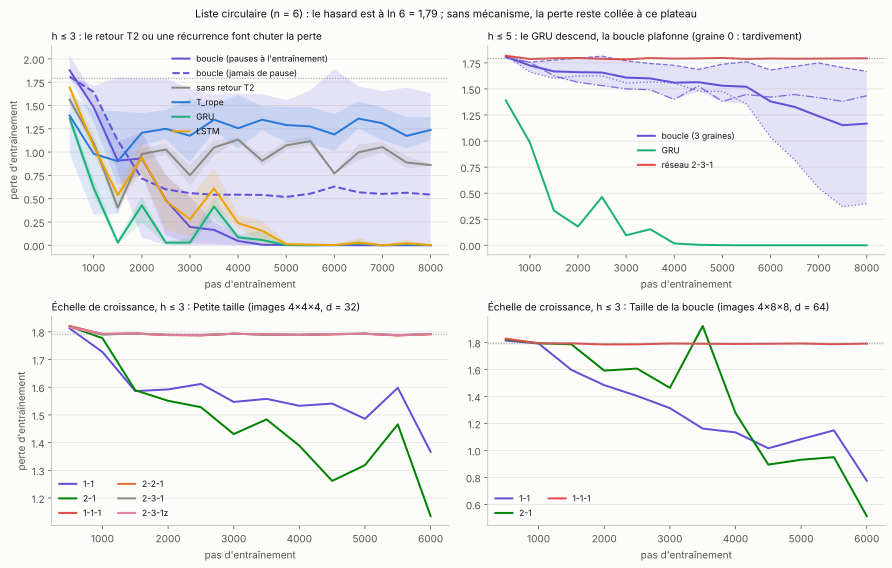
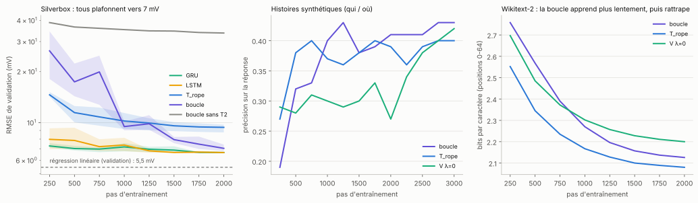
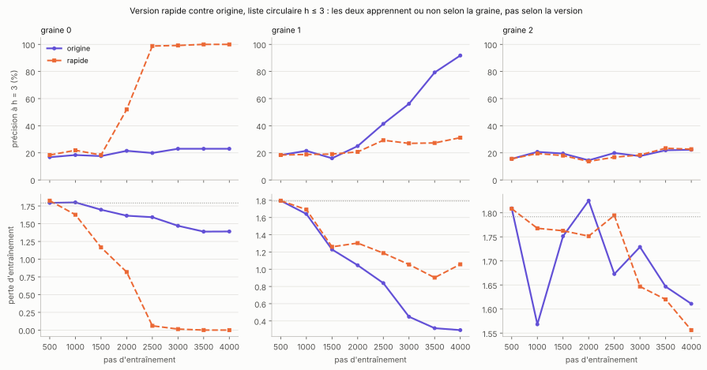

[Sommaire](README.md) · [← Partie 13](13_tinystories.md)

# Partie 14 — Les courbes d'apprentissage : à quelle vitesse ça descend, où sont les plateaux

> **Ce qu'il faut retenir**
>
> - Presque partout, la perte suit le même scénario : un **plateau près du hasard**, puis une **chute brutale** quand le mécanisme est trouvé. La durée du plateau est la vraie différence entre modèles, bien plus que le niveau final.
> - **Les réseaux récurrents descendent plus vite que la rémanence, partout** : S3 (GRU et LSTM sous 0,1 dès les 500 premiers pas, la rémanence en 500 à 750), S3M (500 contre 750 à 1 500), liste circulaire (1 500 pas pour le GRU contre 2 500 à 3 500 pour la rémanence), Silverbox (250 pas contre 1 000 à 1 250).
> - **Les témoins sans retour T2 et T_rope restent sur le plateau** (S3 : 0,8 ; liste circulaire : perte irrégulière autour de 1 à 1,3 pour T_rope), et le réseau 2-3-1 ne quitte jamais ln 6.
> - **La rémanence est souvent en retard et dépend de la graine** : S4 décroche à 6 000, 13 000 pas ou jamais selon la graine ; sur la liste jusqu'à h = 5, 1 graine sur 3 descend nettement ; sur Wikitext-2 elle est derrière T_rope au début, l'écart se réduit (0,22 → 0,05 bit par caractère de 500 à 2 000 pas) sans être comblé.
> - **Les échelles de croissance à la taille de la rémanence ne sont pas finies** : les courbes 1-1 et 2-1 descendent encore à 6 000 pas, ce qui explique pourquoi le critère n'était pas atteint. Seule la couche intermédiaire (1-1-1) reste collée au hasard.

**Lire ces courbes.** (i) La perte tracée est celle d'**un seul lot** au pas noté, donc bruitée ; les bandes sont min/max sur les graines. (ii) Pour S3, S4 et S5, le **curriculum augmente la longueur** des séquences : la perte moyenne par position peut monter sans que le modèle se dégrade (S5 : 3,8 → 4,4 en 3 000 pas). (iii) Les points sont enregistrés tous les 250 ou 500 pas : « moins de 500 pas » veut dire « dès le premier point ». (iv) Les journaux d'origine ne sont pas dans le dépôt ; `scripts/courbes_logs.py` les a regroupés dans `results/courbes_logs.json`. Les runs TinyStories (parties 13) n'avaient pas de courbe sauvegardée (seulement le point à 500 pas et le résultat final) ; `ts_remanence.py` en enregistre désormais une.

## 14.1 État et mémoire : S3, S3M, S4, S5

Pas à partir duquel la perte (ou la précision pour S4) passe le seuil, par graine :

| Tâche (seuil) | GRU | LSTM | Rémanence | Sans retour T2 | T_rope | Réseau 2-3-1 |
|---|---|---|---|---|---|---|
| S3 (perte < 0,1) | ≤ 500 ×3 | ≤ 500 ×3 | ≤ 500 ×4, 750 | jamais ×5 (≈ 0,8) | – | – |
| S3M (perte < 0,1) | ≤ 500 ×3 | ≤ 500 ×3 | 750, 750, 1 500 | jamais ×3 | pas de baisse durable (voir ci-dessous) | – |
| S4 (précision n = 24 ≥ 0,9) | – | – | 6 000, jamais, 13 000 | – | jamais | jamais |
| S4, double loop à branche pleine | – | – | 5 500, 7 000, jamais | – | – | – |

- **S3 et S3M** : la rémanence passe sous 0,1 entre 500 et 1 500 pas, les récurrents dès le premier point. Les témoins sans retour (même largeur, 4 couches, ou T2 écrivant dans l'image 2) restent entre 0,5 et 1 : ils **ne décollent jamais**, pas même lentement. Sur S3M, T_rope touche parfois des pertes très basses (0,004 à 0,1) sur un lot court du curriculum, mais remonte à 0,5-1 au lot suivant : ce n'est pas une baisse durable.
- **S4** : le décrochage n'est pas progressif. La perte de la rémanence descend lentement de ≈ 2 à ≈ 1 en 6 000 pas, puis chute ; la graine 1 ne chute jamais dans les 15 000 pas. T_rope oscille sans tendance claire, le réseau 2-3-1 ne descend qu'en toute fin (0,6 à 15 000 pas, précision toujours à 30 %).
- **S5** : les cinq modèles (rémanence, T_rope, réseau 2-3-1, avec et sans retour, GRU) font la **même** courbe : montée de 3,8 à 4,4 avec la longueur du curriculum, puis palier (4,26 à 4,39, hasard = ln 120 = 4,79). Aucun n'a commencé à décrocher : on ne sait pas ce que donnerait un budget 4 fois plus long, mais S4 décrochait entre 5 000 et 14 000 pas.

## 14.2 Liste circulaire et échelle de croissance

- **h ≤ 3 (haut gauche)** : GRU (≈ 1 500 pas) < rémanence (2 500 à 3 500 avec pauses ; 2 000 pour 2 graines sur 3 sans pause) < LSTM (2 500 à 4 500). Le témoin sans retour T2 passe par un creux (≈ 0,4 à 1 500 pas) puis **remonte** vers 0,9 ; T_rope fait pareil autour de 1,2. Ni l'un ni l'autre ne retrouve la baisse.
- **h ≤ 5 (haut droite)** : le GRU descend en 1 500 pas et reste à zéro. La rémanence plafonne autour de 1,2 à 1,7 (hasard 1,79) ; une seule des trois graines passe à ≈ 0,4 en fin de run. Le réseau 2-3-1 n'a pas quitté ln 6 une seule fois.
- **Échelle de croissance, petite taille (bas gauche)** : 1-1 et 2-1 descendent lentement jusqu'à 1,4 et 1,1 sans décrocher ; toutes les autres configurations (couche intermédiaire, 2-3-1 avec ou sans initialisation à zéro) sont collées à ln 6 dès le premier point.
- **Échelle de croissance, taille de la rémanence (bas droite)** : 1-1 et 2-1 descendent de façon régulière jusqu'à 0,8 et 0,5, **encore en baisse au dernier pas**. À 6 000 pas, le budget est donc court, pas que ces configurations échouent. 1-1-1 reste collé à ln 6 : l'ajout d'une couche intermédiaire est le seul changement qui empêche de démarrer (une graine).

## 14.3 Données réelles et langage

- **Silverbox** : GRU et LSTM sont sous 10 mV dès le premier point (250 pas) et gagnent peu ensuite ; la rémanence démarre à 26 mV (moyenne), passe sous 10 mV à 1 000-1 250 pas et descend jusqu'à 7 mV ; T_rope plafonne à 9-10 mV. Aucun n'atteint la régression linéaire sur la validation (5,5 mV). Le témoin sans T2 reste à 34-40 mV.
- **Histoires synthétiques** (qui / où) : trois courbes bruitées qui montent de 0,2-0,3 à 0,4-0,43, sans écart net entre rémanence et T_rope ; le V λ=0 est derrière jusqu'à 2 500 pas.
- **Wikitext-2** : la rémanence commence derrière T_rope (2,57 contre 2,35 bit par caractère à 500 pas) et se rapproche (2,13 contre 2,08 à 2 000 pas) : elle apprend plus lentement et rattrape en partie.
- **TinyStories** : pas de courbe (voir plus haut). Les seuls points sont ceux de la sauvegarde partielle du run ViT (500 pas : 2,10 bit par caractère sur 128-256 pour la rémanence pré-entraînée, 1,59 pour T_rope), puis le final à 600 pas (2,03 et 1,57) : T_rope y avait fini presque sa descente dès 500 pas, la rémanence baissait encore.

## 14.4 La version rapide apprend-elle comme l'originale ?

Même graine, mêmes données, même initialisation, 4 000 pas, liste circulaire h ≤ 3 (amendement 38). La version rapide a les mêmes sorties et gradients que l'originale à 1e-6 près, mais **les trajectoires divergent** : des écarts d'arrondi s'amplifient pendant le plateau, et la graine détermine quand (ou si) le plateau est franchi.

| Graine | Origine : précision h = 3 finale (pas où ≥ 0,9) | Rapide : précision h = 3 finale (pas où ≥ 0,9) |
|---|---|---|
| 0 | 0,23 (jamais) | **1,00 (2 500)** |
| 1 | **0,92 (4 000)** | 0,31 (jamais) |
| 2 | 0,22 (jamais) | 0,23 (jamais) |

**Une graine sur trois réussit dans chaque version, mais pas la même.** Rien n'indique que la version rapide apprend moins bien (ni mieux) : l'écart d'une version à l'autre est du même ordre que l'écart d'une graine à l'autre. Avec trois graines, on ne peut pas détecter une différence de taux de réussite plus fine. Gain de temps sur cette tâche (séquences courtes, batch 64, CPU) : ≈ 13 % (806-815 s contre 924-932 s).

## 14.5 Ce que les courbes changent

- **Vitesse d'apprentissage et pas seulement niveau final** : la comparaison à nombre de pas égaux (toutes les parties) favorise les récurrents ; la rémanence est souvent « trouvée » plus tard (S4, listes), donc plusieurs de nos résultats nuls à budget court (listes à h ≤ 5, échelle de croissance, S5, ViT pré-entraîné) peuvent être des plateaux non encore franchis. Aucun de ces budgets n'a été prolongé jusqu'à une saturation.
- **Les chutes brutales sont dépendantes de la graine** (S4, h ≤ 5). Une seule graine ne suffit pas à conclure sur « jamais » ni sur « à tel pas ».
- **Pour la suite** : tracer la courbe de **précision** (pas seulement la perte) à chaque point, et enregistrer des courbes pour tous les runs à venir (déjà fait pour `ts_remanence.py`).

Code : `scripts/courbes_logs.py`, `scripts/figures.py` (`p14_*`), données : `results/courbes_logs.json`.
