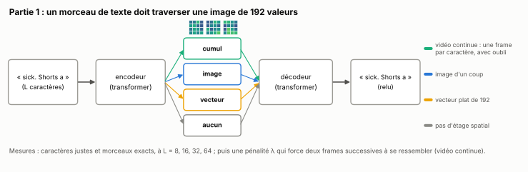
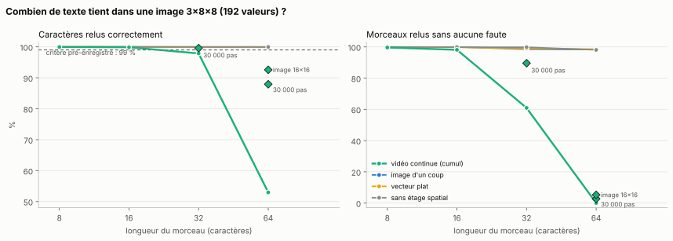
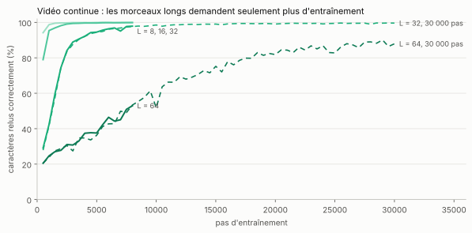
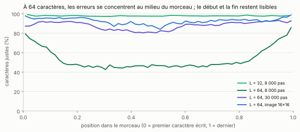
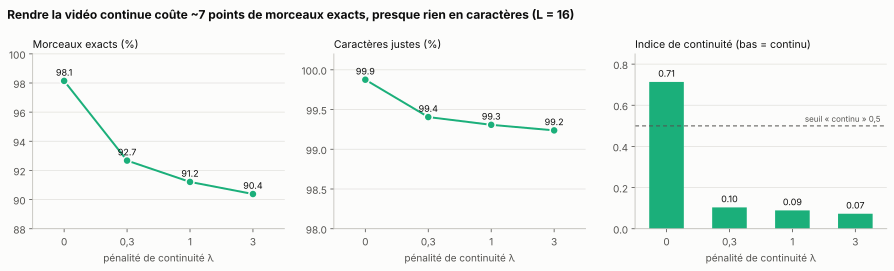
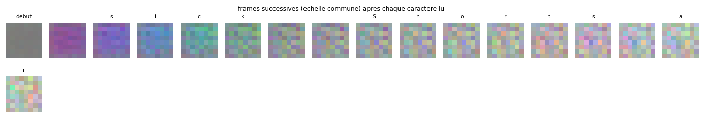
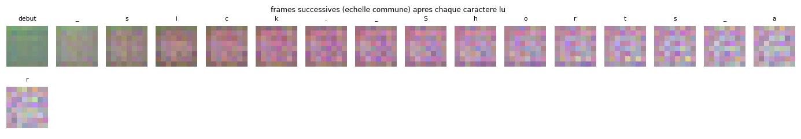

[Sommaire](README.md) · [← Partie 0](0_idee.md) · [Partie 2 →](2_video.md)

# Partie 1 — Le texte tient-il dans une image ?

> **Ce qu'il faut retenir**
>
> - Une image 3×8×8 (192 valeurs) peut porter un morceau de texte : la **vidéo continue** (une frame par caractère, avec oubli) relit 99,9 % des caractères à 16 caractères et 97,9 % à 32, avec moitié moins de paramètres que les autres bras.
> - À 64 caractères elle échoue (53 %), mais c'est surtout une question d'entraînement : 87,9 % avec 30 000 pas au lieu de 8 000, 92,6 % avec une image 16×16.
> - Les erreurs à 64 caractères se concentrent **au milieu** du morceau : le début et la fin restent lisibles.
> - Forcer la vidéo à être continue (λ > 0) fait passer l'indice de continuité de 0,71 à 0,10 et coûte 7 points de morceaux exacts, 0,5 point de caractères.
> - Critère pré-enregistré « l'étape 2 avec vidéo continue est justifiée » (cumul réussit à L ≥ 16) : **atteint**.

## 1.1 Montage

Un encodeur écrit un morceau de L caractères de TinyStories dans 192 valeurs, un décodeur le relit d'un coup. Quatre façons de passer par les 192 valeurs, même décodeur :

| bras | ce qui se passe entre l'encodeur et le décodeur |
|---|---|
| **cumul** (bras principal) | une frame par caractère : `frame_t = oubli_t × frame_(t−1) + résidu_t`, calculés par un petit réseau convolutif qui lit la frame et le caractère ; aucune position |
| image | un transformer encode tout le morceau, puis 3 convolutions 3×3 sur l'image |
| vecteur | pareil, avec un MLP au même nombre de paramètres sur un vecteur plat |
| aucun | pas d'étage entre l'encodeur et le décodeur |

Bruit σ = 0,1 sur le latent à l'entraînement, normalisation par échantillon : l'échelle ne peut rien stocker. 8 000 pas, une graine, critère : ≥ 99 % des caractères.

## 1.2 Capacité

| caractères justes | L = 8 | 16 | 32 | 64 |
|---|---|---|---|---|
| **cumul** | 100 % | 99,9 % | 97,9 % | 53,0 % |
| image, vecteur, aucun | ≥ 98,1 % de morceaux exacts à toute longueur | | | |

Les bras qui voient tout le morceau d'un coup réussissent partout : ranger 64 caractères dans 192 valeurs n'est qu'une compression. Le bras cumul est le seul non trivial, puisqu'il doit construire l'image caractère par caractère, sans savoir combien il en reste, en oubliant peu à peu.

Mesures supplémentaires (amendement 2) : bruit σ = 0,3 à L = 16 : 99,9 % ; image 3×16×16 : 99,9 % à L = 16, 92,6 % à L = 64 ; 30 000 pas : 99,6 % à L = 32, 87,9 % à L = 64.

À L = 64 la courbe monte encore à 30 000 pas : la limite observée à 8 000 pas est un sous-entraînement, pas une limite dure de l'image.

## 1.3 Où l'image perd l'information

Le profil est en U : le premier caractère, écrit sur une image vide, et les derniers, écrits juste avant la lecture, restent lisibles ; le milieu est écrasé par ce qui vient après. Plus d'entraînement ou une image plus grande relèvent tout le profil sans changer sa forme.

## 1.4 Rendre la vidéo continue

Sans contrainte, deux frames successives sont aussi éloignées que deux textes différents (indice 0,71). La pénalité `perte = entropie croisée + λ × indice` (amendement 3) rend la trajectoire continue :

| λ | 0 | 0,3 | 1 | 3 |
|---|---|---|---|---|
| morceaux exacts | 98,1 % | 92,7 % | 91,2 % | 90,4 % |
| caractères | 99,9 % | 99,4 % | 99,3 % | 99,2 % |
| indice de continuité | 0,71 | 0,10 | 0,09 | 0,07 |

Les frames d'un même morceau, sans et avec pénalité (L = 16) :

Elles ressemblent à une texture qui s'épaissit, pas à des formes : rien ne pousse le modèle à dessiner quelque chose de lisible par un humain.

## 1.5 Structure (analyses sur CPU, exploratoires)

Sur les modèles sauvegardés (`results/an_summary.md`) :

- **Pas d'information localisée.** Effacer un bloc 2×2 de l'image abîme le texte un peu partout ; l'information mutuelle entre bloc effacé et position abîmée n'est pas supérieure au hasard (p = 1,00).
- **Pas de classes lexicales.** La classe du caractère (espace, voyelle, consonne) explique 2,8 % de la localisation de l'écriture, contre 1,1 % pour des regroupements arbitraires.
- **L'écriture dépend du temps** plus que du caractère : R² 0,175 pour l'instant t à λ = 0, 0,062 à λ = 1.
- Pas de dérive spatiale de l'écriture au fil du morceau (0,3 pixel).

## 1.6 Bilan

- **Ce qui marche** : le canal texte → image → texte, construit caractère par caractère, sans position, avec un encodeur deux fois plus petit.
- **Limites** : une graine par cas ; le décodage parallèle est plus dur que l'autorégressif, un échec à grand L peut en venir ; on mesure la fidélité, pas le raisonnement.
- **Pour la suite** : ce résultat autorise l'étape 2, où l'image n'est plus relue par un décodeur mais lue par un transformer qui prédit le token suivant.

Code : `src/autoencoder.py`, `src/ae_run.py`, `src/ae_analysis.py`. Résultats : `results/ae_*`, `results/an_*`. Protocole : amendements 1 à 4.
