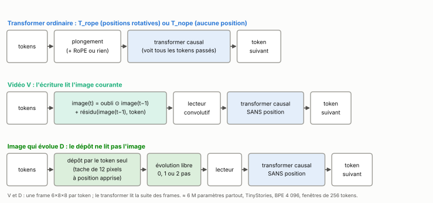
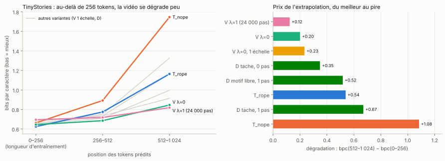
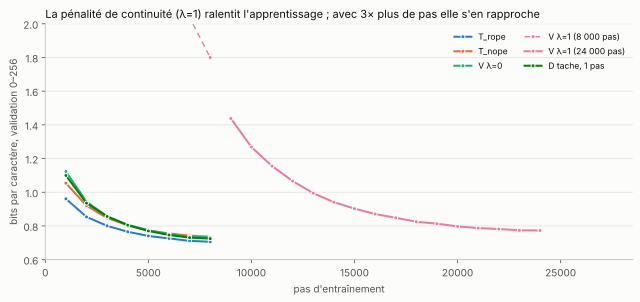
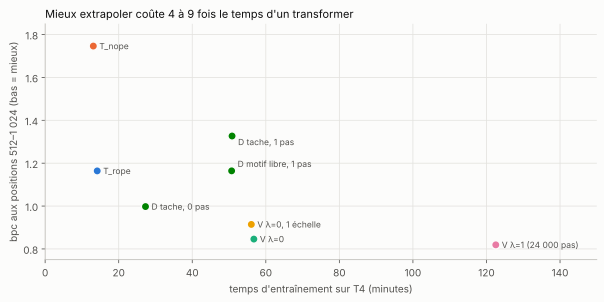
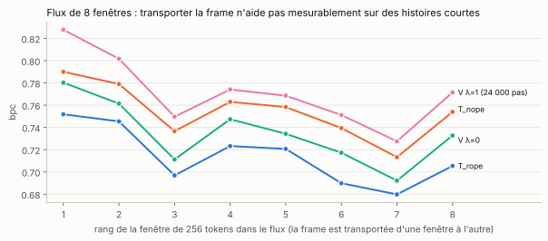

[Sommaire](README.md) · [← Partie 1](1_autoencodeur.md) · [Partie 3 →](3_etat.md)

# Partie 2 — Un transformer qui ne voit que la vidéo

> **Ce qu'il faut retenir**
>
> - Sur TinyStories (≈ 6 M paramètres, fenêtres de 256 tokens), un transformer **sans aucune position** qui ne lit que la vidéo fait 0,645 bit par caractère, contre 0,625 pour T_rope : **compétitif**.
> - Au-delà de la longueur d'entraînement, il se dégrade beaucoup moins : **0,846 contre 1,164** à 512–1 024 tokens. T_nope s'effondre (1,746).
> - La pénalité de continuité coûte surtout du temps : à 8 000 pas V λ=1 est mauvais (1,80 bpc), à 24 000 pas il revient à 5,6 % de V λ=0 sur la validation et extrapole le mieux de tous (0,819).
> - L'évolution libre de l'image (D) n'apporte rien. Le gain vient d'un **hybride récurrence + attention**, pas de la nature « image ».
> - Coût : 4 à 9 fois le temps de T_rope.

## 2.1 Montage

TinyStories, BPE à 4 096 tokens, fenêtres de 256 tokens, 8 000 pas, une graine. Évaluation par tranches de position jusqu'à 1 024 tokens, la frame étant transportée d'une fenêtre à la suivante. Modèles décrits dans le [schéma](../../figures/schemas/modeles.svg) et la [partie 0](0_idee.md#03-les-modèles-par-leur-nom).

## 2.2 Dans la longueur et au-delà

| modèle | 0–256 | 256–512 | 512–1 024 | continuité | temps |
|---|---|---|---|---|---|
| T_rope | **0,625** | 0,775 | 1,164 | – | 14 min |
| T_nope | 0,662 | 0,892 | 1,746 | – | 13 min |
| V λ=0 | 0,645 | 0,686 | 0,846 | 0,43 | 57 min |
| V λ=0, 1 échelle | 0,680 | 0,735 | 0,914 | 0,73 | 56 min |
| V λ=1 (24 000 pas) | 0,695 | 0,718 | **0,819** | 0,01 | 123 min |
| D motif libre, 1 pas | 0,647 | 0,735 | 1,164 | 0,45 | 51 min |
| D tache, 0 pas | 0,649 | 0,710 | 0,998 | 0,43 | 27 min |
| D tache, 1 pas | 0,656 | 0,751 | 1,327 | 0,50 | 51 min |

Deux échelles de temps aident (0,846 contre 0,914 pour une seule). Les variantes D, où le token dépose une tache sans lire l'image, extrapolent moins bien que V, et l'évolution libre les dégrade plutôt (1,327 contre 0,998).

## 2.3 Apprentissage et coût

V λ=1 à 8 000 pas est à 1,80 bpc de validation : la pénalité freine l'apprentissage. Prolongé jusqu'à 24 000 pas (amendement 7), il revient à 0,773 bpc de validation, soit +5,6 % sur V λ=0 (critère de compétitivité raté de peu) et devient le meilleur au-delà. Le verdict sur la pénalité est donc **indéterminé**, pas « nuisible » : les budgets de pas ne sont pas égaux.

## 2.4 Un flux de fenêtres

Sur 8 fenêtres consécutives, la frame transportée ne fait pas mieux que le transformer qui repart de zéro à chaque fenêtre (T_rope 0,752 → 0,705, V 0,780 → 0,733) : les histoires de TinyStories sont trop courtes pour qu'un contexte lointain serve.

## 2.5 Verdicts (amendements 5 à 7)

| critère pré-enregistré | verdict |
|---|---|
| 1. V compétitif à 256 tokens | **atteint** |
| 2. V extrapole mieux que T_rope | **atteint** |
| 3. la pénalité de continuité nuit | **indéterminé** (budget inégal ; à 24 000 pas, non) |
| 5. robustesse au bruit | mesure échouée ici, refaite sur CPU ([partie 7](7_analyses.md)) |
| 6. deux échelles utiles | **atteint** |

## 2.6 Bilan

- **Ce qui marche** : sans position, une vidéo qui accumule les tokens suffit à un transformer pour modéliser des histoires, et il généralise mieux en longueur que RoPE.
- **Interprétation prudente** : V est un hybride (une récurrence écrit l'image, l'attention lit les images passées). L'extrapolation vient très probablement de là ; rien n'indique que le format « image » y soit pour quelque chose.
- **Limites** : une graine ; budgets de pas inégaux pour λ=1 ; le test de rappel de listes ([fausses pistes](../fausses-pistes/README.md#rappel-de-listes-aléatoires-amendement-8)) montre qu'aucun de ces modèles ne recopie une suite de tokens aléatoires.

Code : `src/s2_models.py`, `src/s2_run.py`, `src/config.py`. Résultats : `results/s2_*`. Protocole : amendements 5, 6, 7, 9.
