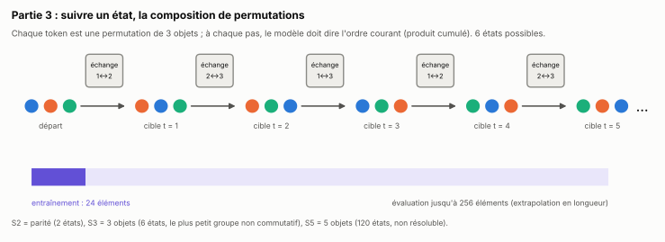
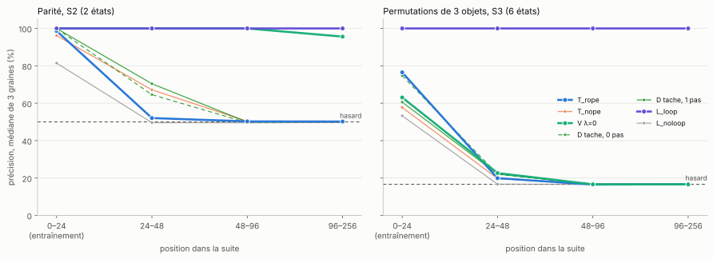
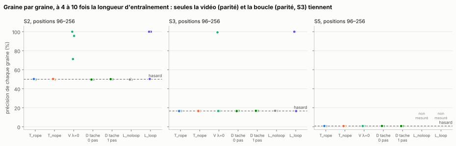
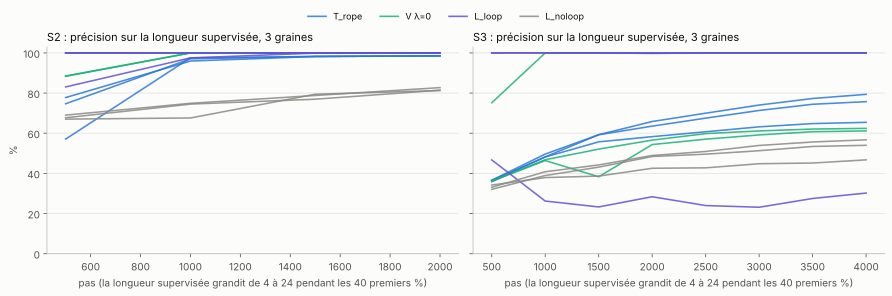
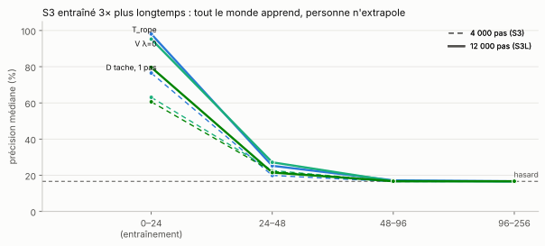

[Sommaire](README.md) · [← Partie 2](2_video.md) · [Partie 4 →](4_boucle.md)

# Partie 3 — Suivre un état

> **Ce qu'il faut retenir**
>
> - Sur la **parité** (S2), la vidéo extrapole : 96 % de précision médiane à 96–256 éléments, après un entraînement sur 24. Tous les transformers et les variantes D retombent au hasard dès 48.
> - Sur les **permutations de 3 objets** (S3), une seule graine de V sur trois réussit ; aucun autre modèle de l'étape 2 n'apprend même la longueur d'entraînement.
> - Entraîner 3 fois plus longtemps (S3L) fait apprendre la longueur d'entraînement à tout le monde, mais **personne n'extrapole**.
> - S5 (120 états) : personne n'apprend (5 à 9 % pour 0,8 % de hasard).
> - Ce sont ces résultats maigres qui motivent la rémanence de la partie 4, qui figure déjà sur les graphes ci-dessous.

## 3.1 Montage

Entrée : une suite d'éléments du groupe S_k, un token par élément. Cible à chaque position : le produit cumulé. Entraînement sur 24 éléments avec un curriculum (la longueur supervisée passe de 4 à 24 pendant les 40 premiers % des pas), évaluation jusqu'à 256. Modèles de ≈ 0,8 M paramètres, 3 graines (amendement 10).

## 3.2 Résultats

| précision médiane (%) | 0–24 | 96–256 |
|---|---|---|
| S2 T_rope | 99 | 50 |
| S2 T_nope | 96 | 50 |
| S2 V λ=0 | 100 | **96** [71–100] |
| S2 D tache | 100 | 50 |
| S3 T_rope | 76 | 17 |
| S3 V λ=0 | 63 [61–100] | 17 [17–99] |
| S3 D tache | 75 / 61 | 17 |
| S5 (tous) | 5–9 | 0,8 (hasard) |

Le hasard vaut 50 % (S2), 17 % (S3) et 0,8 % (S5).

La médiane cache la variance : sur S3, V a une graine à 99 % et deux au hasard. Une architecture qui réussit une fois sur trois n'a pas « appris S3 », elle a eu une bonne initialisation.

## 3.3 Entraînement long (amendement 11)

Avec 12 000 pas (graines 3 à 5), T_rope atteint 98 % dans la longueur d'entraînement, V 95 %, D 80 %, mais tous sont au hasard au-delà de 48. Les graines 6 à 8 prévues n'ont pas été lancées.

## 3.4 Bilan

- **Ce qui marche** : la vidéo extrapole la parité, un état à 2 valeurs, sur 2 graines sur 3 au-delà de 96–256 (la troisième à 71 %).
- **Ce qui ne marche pas** : dès que l'état ne commute plus (S3), la vidéo seule ne suffit pas de façon fiable, et un transformer apprend une approximation qui ne tient que sur la longueur vue.
- **Pourquoi c'est attendu** : un transformer apprend sur ces tâches des « raccourcis » qui tiennent sur la longueur vue et cassent au-delà (Liu et al., 2023) ; pour S5, un transformer de profondeur fixe ne peut même pas représenter la solution (Merrill et al., 2024). Une récurrence le peut, à condition de l'apprendre. V est récurrent dans l'écriture, mais son écriture est une petite convolution qui n'a pas trouvé comment composer des permutations.
- **Limites** : 3 graines ; S3L incomplet ; la profondeur du lecteur n'a pas été variée.

Code : `src/s3_tasks.py`. Résultats : `results/st_S2_*`, `st_S3_*`, `st_S3L_*`, `st_S5_*`, `results/st_summary.md`. Protocole : amendements 10 et 11.
