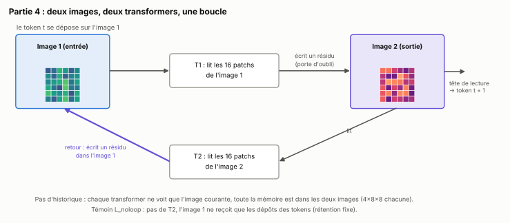
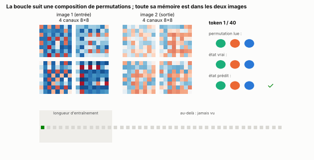
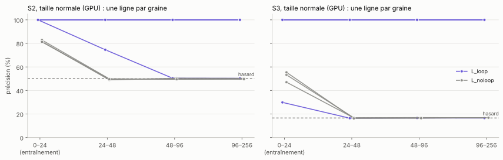
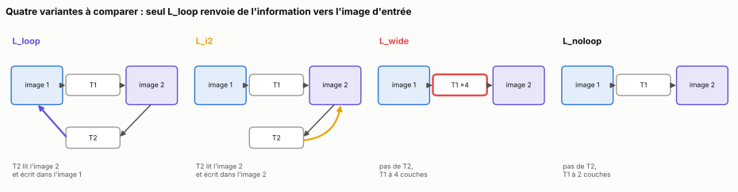
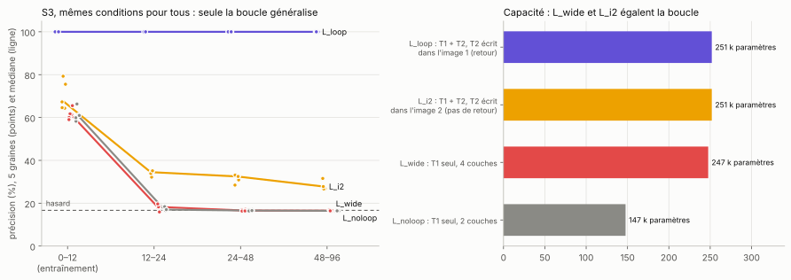
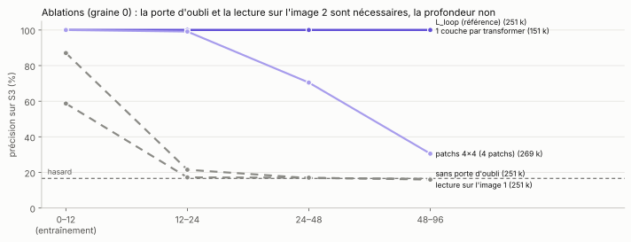
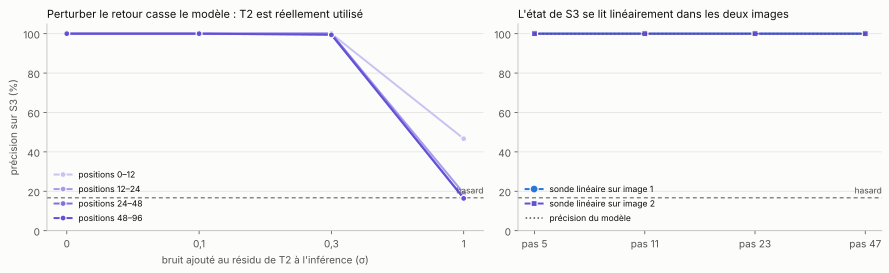
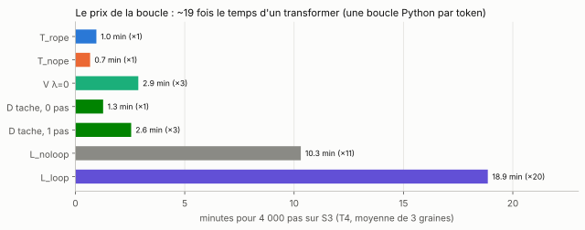

[Sommaire](README.md) · [← Partie 3](3_etat.md) · [Partie 5 →](5_memoire.md)

# Partie 4 — Une rémanence à deux images

> **Ce qu'il faut retenir**
>
> - Deux images, deux transformers qui ne voient que l'image courante : T1 lit l'image 1 et écrit dans l'image 2, T2 lit l'image 2 et **réécrit dans l'image 1**. Aucun historique : toute la mémoire est dans 2 × 256 valeurs.
> - Cette rémanence est la seule architecture du projet qui **apprend S3 et le généralise en longueur** : 100 % jusqu'à 256 éléments sur 2 graines sur 3 (GPU), sur **5 graines sur 5** (CPU).
> - Les contrôles à capacité égale échouent : un T1 à 4 couches (`L_wide`) reste au hasard, un T2 qui écrit dans l'image 2 au lieu de l'image 1 (`L_i2`) plafonne à 28–32 %. C'est le **retour vers l'image d'entrée** qui compte.
> - Ablations : la porte d'oubli et la lecture sur l'image 2 sont nécessaires, une couche par transformer suffit.
> - Le retour est réellement utilisé : du bruit sur la sortie de T2 effondre le modèle. L'état de S3 se lit linéairement dans les deux images.
> - Prix : ≈ 19 fois le temps de T_rope.

## 4.1 Montage (amendement 12)

Images 4×8×8, découpées en 16 patchs de 2×2. À chaque token : le token se dépose sur l'image 1 ; T1 (transformer bidirectionnel sur les 16 patchs) écrit un résidu, avec porte d'oubli, dans l'image 2 ; une tête lit l'image 2 et prédit ; T2 lit l'image 2 et écrit un résidu dans l'image 1. Témoin `L_noloop` : pas de T2, rétention fixe de l'image 1. Même tâches et protocole que la [partie 3](3_etat.md).

Pour la voir tourner, `python scripts/exemple.py boucle` : le modèle entraîné de la section 4.3 lit 40 éléments de S3 (3 fois la longueur d'entraînement) et l'on regarde ses deux images, token par token.

## 4.2 Résultats sur GPU

| tâche | L_loop (dans la longueur \| 96–256) | L_noloop |
|---|---|---|
| S2 | 100 \| 100, 100 \| 50, 100 \| 100 | 83 \| 50, 81 \| 50, 81 \| 50 |
| S3 | 30 \| 17, **100 \| 100, 100 \| 100** | 53 \| 17, 47 \| 17, 55 \| 17 |

Critères de l'amendement 12 : 1, 3 et 4 atteints ; 2 atteint sur S3 et sur 2 graines sur 3 de S2. Une graine sur trois échoue sur S3, sans apprendre même la longueur d'entraînement (30 %).

## 4.3 Est-ce la rémanence, ou seulement plus de paramètres ? (amendement 15)

`L_loop` a 0,90 M paramètres, `L_noloop` 0,49 M. Deux témoins à capacité égale, dans une configuration réduite sur CPU (entraînement sur 12 éléments, évaluation jusqu'à 96, d = 64, 2 000 pas, **5 graines**, mêmes conditions pour tous) :

| modèle | paramètres | dans la longueur | 24–96 |
|---|---|---|---|
| **L_loop** | 252 k | 100 % (5/5) | **100 %** (5/5) |
| L_i2 | 252 k | 64–79 % | 28–32 % |
| L_wide | 248 k | 59–66 % | 16–17 % (hasard) |
| L_noloop | 148 k | 58–66 % | 17 % (hasard) |

Ni la capacité (`L_wide`) ni la présence d'un second transformer (`L_i2`) ne suffisent. **Verdict pré-enregistré « rémanence causale » : atteint.** Transparence : l'amendement a été écrit après la graine 0 de `L_loop` et `L_noloop`, avant les autres.

## 4.4 Ablations (amendement 16, graine 0)

| variante | 0–12 | 24–48 | 48–96 |
|---|---|---|---|
| L_loop (référence) | 100 | 100 | 100 |
| 1 couche par transformer (152 k paramètres) | 100 | 100 | 100 |
| patchs 4×4 (4 patchs) | 100 | 70 | 31 |
| sans porte d'oubli | 87 | 17 | 16 |
| lecture sur l'image 1 au lieu de l'image 2 | 59 | 17 | 16 |

La profondeur n'est pas nécessaire : c'est pourquoi les parties 5 et 6 utilisent des transformers à une couche (`L_loop1`). Des patchs plus gros dégradent l'extrapolation. Une seule graine : à lire comme exploratoire.

## 4.5 Le retour est-il utilisé ? (exploratoire)

- **Bruit sur le résidu de T2** à l'inférence : sans effet à σ = 0,1, 99,4 % à σ = 0,3 au-delà de 48, effondrement à σ = 1 (47 % puis 16 %). T2 est utilisé, avec une marge de robustesse.
- **Sonde linéaire** de l'état vrai : lisible à 100 % depuis l'image 1 comme depuis l'image 2, aux pas 5, 11, 23 et 47.

## 4.6 Coût

La rémanence traite les tokens un par un en Python (deux transformers par token) : 18,9 minutes pour 4 000 pas sur S3, contre 1,0 pour T_rope. Rien n'a été fait pour l'accélérer.

## 4.7 Bilan

- **Ce qui marche** : un état fait de deux images, sans aucun accès au passé, suffit à apprendre une composition non commutative et à la suivre 10 fois plus loin que l'entraînement. Le mécanisme est identifié : le retour T2 → image 1.
- **Lien avec l'existant** : c'est une récurrence dont la transition est un transformer sur des patchs (proche des RNN à transition profonde et des « Universal Transformers » appliqués au temps), avec un état spatial. Ce qui est propre ici : l'état est une image fixe, la rémanence passe par une seconde image, et les contrôles à capacité égale isolent le rôle du retour.
- **Limites** : contrôles sur une seule tâche (S3), dans une configuration réduite, à une seule taille de modèle ; une graine sur trois échoue sur GPU ; ablations sur une graine ; coût élevé.

Code : `src/s4_loop.py`, `src/s3_tasks.py`, `scripts/cpu_boucle.py`, `scripts/cpu_boucle_causal.py`. Résultats : `results/st_S2_L_*`, `st_S3_L_*`, `st_S3c_*`, `cpu_boucle_causal_s0.json`, `st4_summary.md`. Protocole : amendements 12, 15 et 16.
