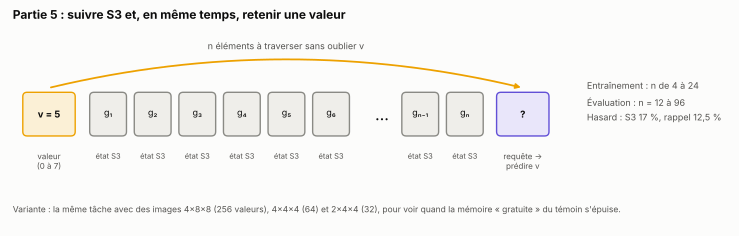
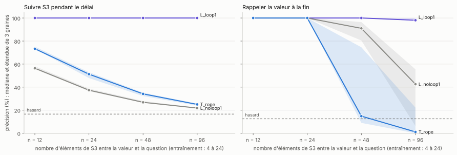
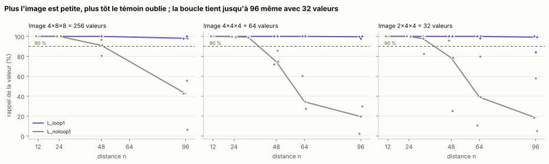
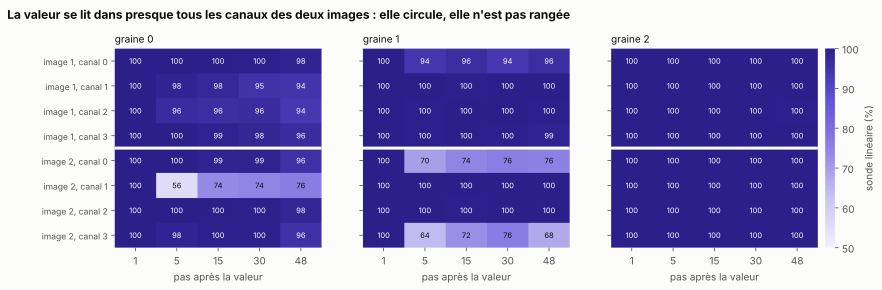

[Sommaire](README.md) · [← Partie 4](4_boucle.md) · [Partie 6 →](6_langage.md)

# Partie 5 — Suivre un état et retenir une valeur

> **Ce qu'il faut retenir**
>
> - La rémanence à une couche (`L_loop1`) suit S3 **et** retient une valeur à travers 96 éléments : rappel ≥ 98 %, S3 à 100 %, 3 graines sur 3.
> - Le témoin sans rémanence retient la valeur « gratuitement » jusqu'à ≈ 48 éléments (80–96 %), puis l'oublie (6–55 % à 96). T_rope oublie dès 48. Ni l'un ni l'autre ne suit S3.
> - Plus l'image est petite, plus tôt le témoin oublie ; la rémanence tient jusqu'à 96 même avec **32 valeurs** (2×4×4). Hypothèse soutenue, faiblement.
> - La valeur se lit dans presque tous les canaux des deux images pendant tout le délai : elle **circule** entre les images, elle n'est pas rangée dans des canaux dédiés.

## 5.1 Montage (amendement 17)

Séquence `[valeur v ∈ 0..7] [n éléments de S3] [requête]` : prédire l'état S3 à chaque élément, puis v à la requête. Entraînement n ∈ [4, 24], évaluation n = 12 à 96. CPU, d = 64, 3 000 pas, 3 graines. Hypothèse de départ (Mathis) : la rémanence rangera la mémoire longue dans certains canaux.

## 5.2 Résultats

| modèle | | n = 12 | 24 | 48 | 96 |
|---|---|---|---|---|---|
| L_loop1 | S3 / rappel | 100 / 100 | 100 / 100 | 100 / 100 | 100 / 98–100 |
| L_noloop1 | S3 | 56–58 | 37–39 | 27–28 | 22 |
| | rappel | 100 | 100 | 80–96 | 6–55 |
| T_rope | S3 | 73–75 | 48–53 | 32–35 | 24–26 |
| | rappel | 100 | 100 | 9–75 | 0–22 |

Plages sur 3 graines ; hasard : S3 17 %, rappel 12,5 %.

**Verdicts pré-enregistrés** : (a) mémoire tenue : **atteint** (rappel ≥ 98 % à 48 et 96, S3 100 %, 3/3). (b) durée de vie ≥ 96 pas : la limite de l'évaluation, non dépassée. (c) « la rémanence aide » : **non atteint à n = 48**, car le témoin retient encore 80–96 % ; la différence apparaît à n = 96 pour le rappel, et partout pour S3.

## 5.3 La taille de l'image (amendement 18)

Hypothèse (Mathis) : plus l'image est petite, plus tôt la mémoire longue demande la boucle.

| image | modèle | n = 32 | 48 | 64 | 96 |
|---|---|---|---|---|---|
| 4×8×8 (256) | L_noloop1 | – | 80 / 91 / 96 | – | 6 / 55 / 43 |
| 4×4×4 (64) | L_noloop1 | 99 / 100 / 99 | 75 / 86 / 72 | 27 / 60 / 34 | 2 / 30 / 20 |
| 2×4×4 (32) | L_noloop1 | 99 / 82 / 98 | 79 / 25 / 96 | 39 / 11 / 80 | 18 / 5 / 58 |
| 4×4×4 | L_loop1 | 100 ×3 | 100 ×3 | 100 ×3 | 100 / 100 / 98 |
| 2×4×4 | L_loop1 | 100 ×3 | 100 ×3 | 100 / 100 / 98 | 100 / 99 / 84 |

Distance n\* où le rappel médian du témoin passe sous 90 % : entre 48 et 96 pour 4×8×8, 48 pour 4×4×4 et pour 2×4×4. **Verdict : soutenu, faiblement.** La moyenne à n = 48 décroît bien avec la taille (89 → 78 → 67 %), pas celle à n = 96 (35 → 17 → 27 %) ; la variance entre graines est grande ; la référence 4×8×8 n'a pas de point à 32 et 64.

## 5.4 Où est la mémoire ? (sondes, exploratoire)

Une sonde linéaire lit v à 94–100 % sur l'image 1 comme sur l'image 2, à tous les pas du délai (1 à 48), sur les 3 graines, et le plus souvent dans chaque canal pris seul. Quelques canaux de l'image 2 portent moins (56 à 76 % pour les graines 0 et 1) : une spécialisation partielle, pas des canaux dédiés. Le scénario « la valeur patiente dans l'image 2 puis revient » n'est pas observé : l'image 1 la porte aussi.

## 5.5 Bilan

- **Ce qui marche** : la rémanence garde à la fois un état qui change à chaque pas et une valeur figée, dans 32 à 256 valeurs, au moins 4 fois plus loin que l'entraînement.
- **Ce qui est nuancé** : le témoin a une mémoire « gratuite » non négligeable (≈ 50 pas avec 256 valeurs) ; la rémanence n'est nécessaire qu'au-delà, ou dès qu'il faut aussi suivre S3.
- **Limites** : distance maximale testée 96 ; une seule valeur à retenir ; une sonde mesure la lisibilité, pas l'usage causal (pas d'ablation de canaux).

Code : `scripts/cpu_memoire.py`. Résultats : `results/st_S3M_*`. Protocole : amendements 17 et 18.
