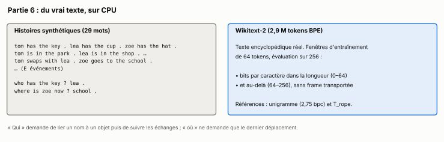
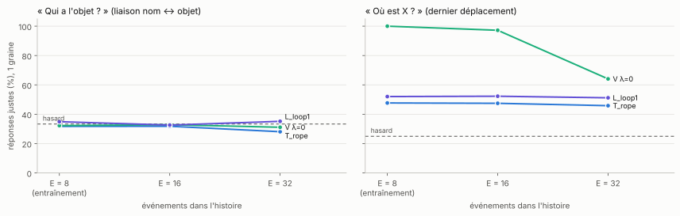
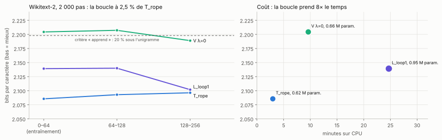
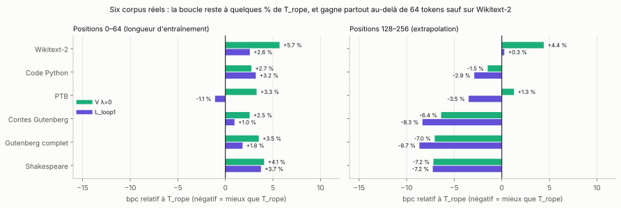
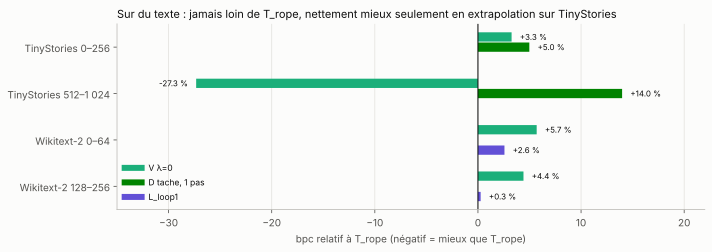

[Sommaire](README.md) · [← Partie 5](5_memoire.md) · [Partie 7 →](7_analyses.md)

# Partie 6 — Et sur du texte ?

> **Ce qu'il faut retenir**
>
> - **Wikitext-2** (vrai texte, CPU, 2 000 pas) : la rémanence fait 2,139 bits par caractère, à **2,5 % de T_rope** (2,086), avec un état de 256 valeurs et aucun accès au passé. Critère « compétitive » : atteint.
> - **Cinq autres corpus réels** (partie 6.3) : la rémanence reste entre −1 % et +4 % de T_rope à 64 tokens et fait 3 à 9 % mieux au-delà de 64 tokens sur code, contes, Gutenberg complet et Shakespeare, où T_rope se dégrade de 6 à 14 %. Wikitext-2 reste l'exception.
> - Pas d'avantage d'extrapolation mesurable sur Wikitext-2 : T_rope ne se dégrade pas du tout entre 64 et 256 tokens à ce stade d'entraînement, donc le test ne peut pas le montrer.
> - **Histoires synthétiques** : pas de verdict. T_rope et la rémanence n'ont pas convergé en 4 000 pas ; V apprend « où est X ? » (100 %) mais pas « qui a l'objet ? ».

## 6.1 Histoires synthétiques (amendements 19 et 19b)

Pas de TinyStories dans le bac à sable CPU : un corpus généré de 29 mots, où 3 personnes tiennent un objet et sont dans un lieu, puis E événements (échanges d'objets, déplacements), puis 3 questions. Curriculum sur E de 1 à 10, poids ×20 sur les réponses, 4 000 pas, une graine, d = 64. La version 1 avait un bug (histoires tronquées sans leurs questions) : [fausses pistes](../fausses-pistes/README.md#histoires-synthétiques-version-1).

| modèle | E = 8 (entraînement) | E = 16 | E = 32 |
|---|---|---|---|
| T_rope | 32 / 48 | 32 / 47 | 28 / 46 |
| V λ=0 | 32 / **100** | 33 / 97 | 31 / 64 |
| L_loop1 | 35 / 52 | 33 / 52 | 35 / 51 |

« qui » / « où », en % ; hasard 33 % / 25 %.

**Verdict : aucun.** La règle pré-enregistrée exclut un modèle sous 60 % à E = 8 : T_rope et L_loop1 sont exclus. Lecture prudente, non testée : « qui » demande de **lier** un nom à un objet tiré au hasard à chaque histoire puis de suivre les échanges, plus dur que S3 dont les 6 états sont fixes ; « où » ne demande que le dernier déplacement de chaque personne, ce que la vidéo seule sait faire.

## 6.2 Wikitext-2 (amendement 20)

2,9 M tokens BPE d'entraînement, une graine, d = 64, 2 000 pas (≈ 2 M tokens vus), fenêtres d'entraînement de 64 tokens, aucune frame transportée. Évaluation sur 96 fenêtres de 256 tokens.

| modèle | paramètres | temps | 0–64 | 64–128 | 128–256 |
|---|---|---|---|---|---|
| unigramme | – | – | 2,747 | 2,733 | 2,729 |
| T_rope | 0,62 M | 3 min | **2,086** | 2,093 | 2,096 |
| V λ=0 | 0,66 M | 10 min | 2,204 | 2,207 | 2,189 |
| L_loop1 | 0,95 M | 25 min | 2,139 | 2,140 | 2,102 |

| critère pré-enregistré | verdict |
|---|---|
| (a) apprend : ≥ 20 % sous l'unigramme (≤ 2,198) | T_rope et L_loop1 oui ; **V échoue de justesse** (2,204) |
| (b) la rémanence est compétitive : ≤ 1,05 × T_rope | **oui** (2,139) |
| (c) la rémanence extrapole mieux | **non** (2,102 contre 2,096 à 128–256) |

Le pronostic écrit avant la mesure (« la rémanence ne sera pas compétitive », « V et la rémanence se dégraderont moins au-delà de 64 ») est **infirmé** sur les deux points.

## 6.3 Cinq autres corpus (amendement 22)

Même protocole que 6.2 (T_rope, V λ=0, L_loop1, d = 64, 2 000 pas, fenêtres d'entraînement de 64 tokens, une graine), sur cinq corpus accessibles depuis le bac à sable (GitHub, PyPI, bibliothèque standard Python) ; un tokenizer BPE de 4 096 par corpus.

| corpus | tokens (train) | T_rope 0–64 / 128–256 | V λ=0 | L_loop1 |
|---|---|---|---|---|
| Wikitext-2 | 2,9 M | 2,086 / 2,096 | 2,204 / 2,189 | 2,139 / 2,102 |
| code Python | 3,0 M | 1,739 / 1,844 | 1,787 / 1,817 | 1,795 / **1,791** |
| PTB | 1,25 M | 1,622 / 1,635 | 1,675 / 1,656 | **1,604 / 1,578** |
| contes Gutenberg | 0,38 M | 2,051 / 2,199 | 2,104 / 2,059 | 2,071 / **2,016** |
| Gutenberg complet | 3,4 M | 2,190 / 2,494 | 2,267 / 2,318 | 2,229 / **2,278** |
| Shakespeare | 0,31 M | 2,338 / 2,603 | 2,433 / 2,416 | 2,425 / **2,414** |

(bits par caractère, bas = mieux ; unigramme de 2,25 à 3,08 selon le corpus.)

**Verdict (critères pré-enregistrés, L_loop1).** (a) apprend, (b) compétitive (≤ 1,05 × T_rope à 0–64) et (c) extrapole mieux : **atteints sur les cinq nouveaux corpus**. Au-delà de 64 tokens, T_rope se dégrade de 6 à 14 % (code, contes, Gutenberg complet, Shakespeare) alors que la rémanence reste stable à ±3 % : à 128–256, elle fait 3 % (code), 8 % (contes), 9 % (Gutenberg complet) et 7 % (Shakespeare) mieux que T_rope. Sur PTB T_rope ne se dégrade presque pas et la rémanence est meilleure de 1 à 3,5 % partout. **Wikitext-2 reste l'exception** : T_rope n'y dégrade pas. V λ=0 suit le même schéma que la rémanence, un peu moins bien (critère (a) manqué de peu sur Gutenberg complet, critère (c) manqué sur PTB).

Pronostics écrits avant (amendement 22) : « la rémanence n'est pas compétitive sur le code » **infirmé** (+3,2 % à 0–64) ; « extrapole mieux sur le code » confirmé ; « pas d'extrapolation ailleurs » **infirmé** sur quatre corpus ; « surapprentissage sur les contes » non constaté.

**Lecture prudente.** C'est le même signal que celui de la partie 2 (état récurrent borné contre positions apprises) : un transformer à positions RoPE entraîné sur 64 tokens se dégrade au-delà, pas un modèle à état. Cela ne dit pas que la rémanence comprend mieux : la comparaison reste à une graine, à 2 000 pas, avec 0,95 M de paramètres contre 0,62 M, et un coût de 8 fois le temps de T_rope. Un T_rope entraîné sur des fenêtres plus longues (ou avec une interpolation de positions) fermerait peut-être l'écart, ce que ce test ne mesure pas.

## 6.4 Bilan

- **Ce qui marche** : un état de 256 valeurs, sans aucun accès au passé, reste à 2,5 % d'un transformer sur du texte réel, à ce stade d'entraînement.
- **Ce qui ne se voit pas** : l'avantage en longueur de la partie 2 (TinyStories, 6 M paramètres, fenêtres de 256) n'est pas testable ici, la perte étant dominée par des régularités locales.
- **Limites** : une graine, 2 000 pas, des écarts de 2 à 5 % à la limite de ce qu'on peut affirmer ; la rémanence a plus de paramètres (dont 262 k d'embedding) et coûte 8 fois le temps.

Corpus préparés par `scripts/prepare_corpus.py` et `prepare_corpus2.py` (tokenizers dans `tokenizer/`, données dans `data/`, hors dépôt) ; résumé des résultats : `python scripts/resume_lm.py`.

Code : `scripts/cpu_langage.py`, `scripts/cpu_wikitext.py`. Résultats : `results/lm_synth_v2_*`, `results/lm_wiki_*`, `results/lm_<corpus>_*`. Protocole : amendements 19, 19b, 20 et 22. Pour un autre corpus : `CORPUS=<nom> python scripts/cpu_wikitext.py MODELE 0`.
