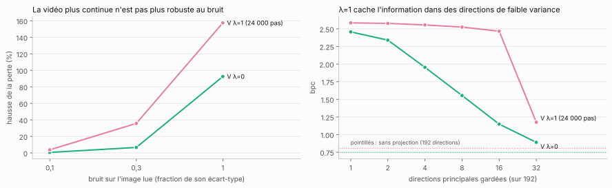
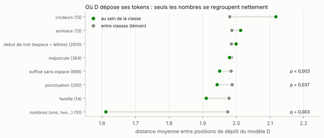
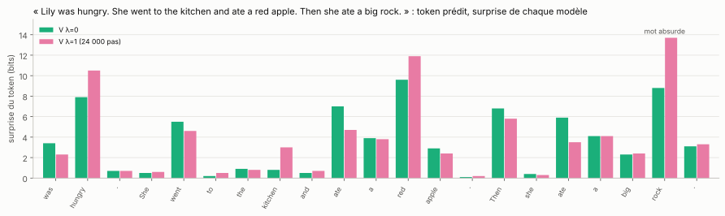

[Sommaire](README.md) · [← Partie 6](6_langage.md) · [Partie 8 →](8_bilan.md)

# Partie 7 — Que contiennent les images ?

> **Ce qu'il faut retenir**
>
> Analyses sans entraînement sur les modèles sauvegardés de la partie 2, toutes exploratoires (amendement 14).
>
> - La vidéo continue (λ=1) **n'est pas plus robuste au bruit** : +157 % de perte à σ = 1 contre +93 % pour λ=0.
> - Son information n'est **pas compacte** : la variance se concentre sur 2 ou 3 directions, mais le transformer lit des directions de faible variance (16 directions sur 192 ne gardent presque rien).
> - Les positions où le modèle D dépose ses tokens ne forment **pas de carte sémantique** : seuls les 10 nombres se regroupent nettement.
> - Un mot absurde (« rock » après « ate a big ») ne provoque pas de pas d'image plus grand que les autres.

## 7.1 Bruit et projection

Sur 500 tokens de textes écrits à la main (5 histoires de 100 tokens), donc des écarts faibles ne sont pas lisibles.

- **Bruit gaussien sur l'image lue** (fraction de l'écart-type de chaque canal) : V λ=0 +1 / +7 / +93 % à σ = 0,1 / 0,3 / 1 ; V λ=1 +4 / +36 / +157 %. L'hypothèse « une trajectoire continue est plus robuste » n'est pas soutenue.
- **Projection sur les k premières directions principales** : V λ=0 descend régulièrement (2,46 à k = 1, 0,89 à k = 32, base 0,75) ; V λ=1 reste à 2,47 jusqu'à k = 16 puis tombe à 1,18 à k = 32 (base 0,81). La continuité n'a pas produit un code compact. Limite : projection linéaire, sans réentraîner le lecteur.
- **Dimension effective** (`scripts/dimension_frames.py`, rapport de participation sur 192 valeurs) : V λ=0 9,9 (rapide) et 1,0 (lent) ; V λ=1 2,4 et 1,8. Les 10 % de valeurs les plus variables portent 99 % de la variance des canaux rapides de V λ=1. Hypothèse non testée : concentrer la variance sur quelques valeurs de grande amplitude est une façon bon marché de satisfaire l'indice de continuité, qui est un rapport.

## 7.2 Où D dépose ses tokens

4 096 tokens × 6 canaux × (x, y), comparés à 300 tirages aléatoires de même taille. Nombres (one … ten) : distance moyenne 1,61 contre 1,97 (p = 0,003). Suffixes (p < 0,003) et ponctuation (p = 0,04) : 2 à 3 % d'écart, réels peut-être mais négligeables. Rien pour les débuts de mot, majuscules, couleurs, animaux, famille. Corrélation entre identifiant du token et coordonnées : |r| ≤ 0,03. Huit classes testées sans correction pour comparaisons multiples.

## 7.3 Une phrase, mot par mot

Sur la phrase de la [partie 0](0_idee.md#02-le-mécanisme), les deux modèles se trompent aux mêmes endroits (« hungry », « red », « rock »). Le film des frames montre que V λ=0 fait ses grands pas aux points, pas après le mot inattendu : rien n'indique que l'image « retravaille » davantage après une surprise. Une seule phrase : anecdotique.

## 7.4 Bilan

- Les images ne sont pas des dessins lisibles : textures sans organisation spatiale nette, information distribuée et parfois dans des directions de faible variance.
- La continuité imposée change la géométrie (variance concentrée) sans rendre le code plus robuste ni plus compact.
- Ce qu'il faudrait pour aller plus loin : une contrainte qui rende l'image lisible (décodeur image → texte entraîné en même temps, ou pénalité de parcimonie), puis refaire ces mesures.

Code : `scripts/analyses_cpu.py`, `scripts/dimension_frames.py`, `scripts/demo_phrase.py`. Résultats : `results/analyses_cpu.json`, `results/s2_decodage.txt`. Protocole : amendement 14 et les mesures exploratoires de l'amendement 7.
