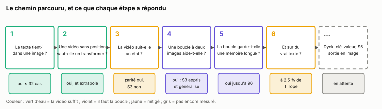
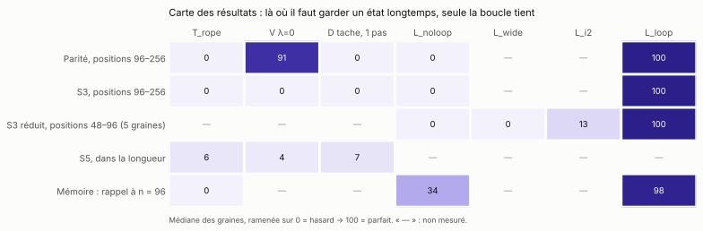

[Sommaire](README.md) · [← Partie 7](7_analyses.md)

# Partie 8 — Bilan

## 8.1 Ce qui marche

1. **Le texte tient dans une image construite caractère par caractère** (partie 1) : 99,9 % à 16 caractères, 97,9 % à 32, avec une porte d'oubli et sans position.
2. **Une vidéo sans position vaut RoPE dans la longueur et extrapole mieux** (partie 2) : 0,846 contre 1,164 bpc à 512–1 024 tokens. Effet d'un hybride récurrence + attention plutôt que de l'image.
3. **La rémanence à deux images apprend S3 et le généralise 10 fois plus loin** (partie 4) ; les témoins à capacité égale échouent ; c'est le retour T2 → image 1 qui compte.
4. **La même rémanence garde une valeur pendant 96 pas tout en suivant S3** (partie 5), même avec 32 valeurs d'état.
5. **Sur du vrai texte, la rémanence reste à quelques % d'un transformer** (partie 6, six corpus) avec un état de 256 valeurs et aucun accès au passé, et se dégrade moins au-delà de 64 tokens sur cinq corpus sur six (3 à 9 % mieux que T_rope à 128–256 tokens ; une graine, 2 000 pas).

## 8.2 Ce qui ne marche pas, ou pas encore

- La vidéo seule ne suit pas un état non commutatif (S3) de façon fiable, et personne ne fait S5 (partie 3).
- Les images ne sont pas lisibles : pas de carte sémantique, information distribuée, la continuité ne rend le code ni compact ni robuste (partie 7).
- Pas de verdict sur les histoires synthétiques (partie 6) ; pas d'avantage d'extrapolation sur Wikitext-2, où T_rope ne se dégrade pas ; sur les cinq autres corpus l'écart vient peut-être de T_rope entraîné sur des fenêtres de 64 seulement (non testé avec des fenêtres plus longues).
- La sortie est encore un token : le décodeur image → texte de la partie 1 n'est pas encore branché derrière la boucle.

## 8.3 Limites honnêtes

- **Graines** : 3 sur GPU, 5 pour les contrôles CPU ; une graine sur trois de L_loop échoue sur S3 en GPU.
- **Portée des contrôles** : faits sur S3 seulement, en configuration réduite, à une taille de modèle.
- **Budgets inégaux** : la pénalité de continuité n'a pas été comparée à pas égaux ; la rémanence coûte 8 à 20 fois le temps d'un transformer.
- **Taille** : tous les modèles font moins de 6 M paramètres ; rien ne dit ce qui se passe à l'échelle.
- **Graines** (parties 9 à 12) : plusieurs résultats récents tiennent à une graine ; la rémanence entraînée jusqu'à 5 sauts n'est pas reproductible (1 graine sur 3).

## 8.4 Position par rapport à l'existant

- **Pensée en images** : les modèles multimodaux qui raisonnent avec des images (o3, Anole, chaînes de pensée visuelles) gardent un squelette verbal ; ici il n'y a pas de tokens intermédiaires, l'état est l'image.
- **Raisonnement latent** : COCONUT remplace les tokens de pensée par des vecteurs continus ; ici l'état est spatial et mis à jour à chaque token d'entrée.
- **Récurrence et suivi d'état** : que les transformers échouent à extrapoler S3/S5 et que des récurrences y arrivent est connu (Liu et al., 2023 ; Merrill et al., 2024). Ce qui est propre ici : un état **fait de deux images**, une transition faite de **transformers sur des patchs**, et des contrôles à capacité égale qui isolent le rôle du **retour vers l'image d'entrée**.
- **Canvas récurrents** : DRAW (2015) écrit itérativement sur un canvas pour générer une image ; ici le canvas est écrit par du texte et lu pour prédire du texte.

## 8.4b Ce que les parties 9 à 12 changent

- **Face aux RNN** : GRU et LSTM réussissent S3, S3 + mémoire et la liste circulaire jusqu'à 3 sauts aussi bien que la rémanence, 5 à 20 fois plus vite ; sur Silverbox, la rémanence est ≈ 13 % derrière (3 graines). L'apport de la rémanence est de donner un état récurrent à un transformer, pas une capacité qu'un RNN n'aurait pas (partie 12).
- **Temps de réflexion** : les pauses n'aident pas sur la liste circulaire (partie 9). La limite à 3 sauts n'est pas levée de façon fiable en entraînant jusqu'à 5 (partie 12.5).
- **Plus d'images** : le double loop (partie 10) et le réseau en couches 2-3-1 (partie 12) n'apprennent pas mieux que la rémanence ; à petite taille, même la rémanence à 2 images échoue (amendement 33b). À tester à la taille de la rémanence (amendement 34) puis sur GPU.
- **S5** reste non appris, GRU compris, à 8 000 pas (amendement 31).
- **Vitesse d'apprentissage** (partie 14) : les courbes montrent un plateau près du hasard puis une chute brutale ; GRU et LSTM franchissent le plateau 2 à 4 fois plus tôt que la rémanence, et plusieurs de nos résultats nuls à budget court (listes jusqu'à 5 sauts, échelle de croissance, S5, ViT pré-entraîné) peuvent être des plateaux non encore franchis.

## 8.5 La suite

**En attente** : l'étape 5 (amendement 13), lancée sur Colab mais sans résultats reçus : profondeur de Dyck, rappel clé-valeur (16 clés, 8 valeurs, 1 à 8 paires à l'entraînement, jusqu'à 16 à l'évaluation), S5 ; L_loop, L_noloop, T_rope, V λ=0, 3 graines. Notebook : `notebooks/etape5_taches.ipynb`.

**Idées testables sur CPU**, par ordre de coût :

1. Contrôles à capacité égale sur d'autres tâches que S3 (Dyck, clé-valeur), et S3 à taille normale.
2. Ablation de canaux dans la tâche de mémoire : la valeur lisible partout est-elle utilisée partout ?
3. V λ=0 entraîné 24 000 pas, pour comparer la pénalité à budget égal.
4. Gradient de difficulté (compteur modulo k, k = 2 à 8) pour voir où la rémanence casse.
5. Plusieurs pas de rémanence par token (le modèle « réfléchit » sans entrée nouvelle).
6. Version langage plus grande : TinyStories avec la rémanence, image plus grande, et le décodeur de la partie 1 en sortie.

**Fait depuis la première liste d'idées** : contrôle de capacité, 5 graines, sondes linéaires, bruit sur T2, ablations (partie 4).
