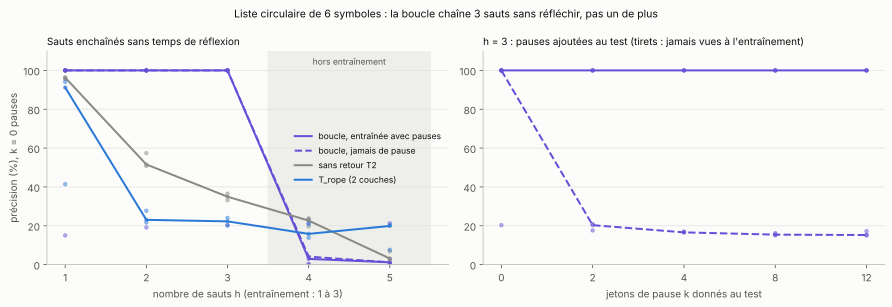

[Sommaire](README.md) · [← Partie 8](8_bilan.md) · [Partie 10 →](10_taches_et_double_loop.md)

# Partie 9 — Le temps de réflexion aide-t-il la rémanence ?

> **Ce qu'il faut retenir**
>
> - Sur une **liste circulaire de 6 symboles** (tâche sans raccourci, vérifiée), la rémanence à une couche apprend à enchaîner **1, 2 et 3 sauts à 100 %** sur 3 graines sur 3. Le témoin sans retour T2 plafonne à 96 / 50–58 / 33–37 %, T_rope (2 couches) à un saut au mieux.
> - **Pas de signature de la réflexion** : la précision à k = 0 pause est déjà de 100 %, et k = 8 ou 12 pauses ne change rien (0 point). Les tours de pause ne servent pas ici.
> - **Pas d'extrapolation** : 4 et 5 sauts, jamais vus à l'entraînement, restent entre 0 et 15 %, même avec 12 pauses.
> - La première tentative (amendement 21, permutation de 6 symboles) était invalide : un raccourci (« répondre x ») que les modèles ont appris. Cette partie la reprend avec une tâche choisie après mesure des raccourcis.

## 9.1 Montage (amendement 23)

**Tâche.** Six paires (a, f(a)) décrivent une permutation cyclique unique de 6 symboles, données en ordre aléatoire (12 tokens), puis une requête, un point de départ x, le nombre de sauts h et k jetons de pause. La réponse est f^h(x), lue à la dernière position. Entraînement : h ∈ {1, 2, 3} (curriculum), k tiré entre 0 et 8. Évaluation : h de 1 à 5, k de 0 à 12 ; h = 4 et 5 ne sont jamais vus.

**Pourquoi une liste circulaire.** Pour h < n, f^h(x) ≠ x et f^h(x) ≠ f^h'(x) : aucun prédicteur qui n'enchaîne pas les h sauts ne dépasse le hasard (précision maximale mesurée : 0,00 sur 200 000 tirages, n = 8 à 32). Une permutation aléatoire ramène sur x avec probabilité 17 à 67 % (amendement 21) ; une fonction aléatoire s'effondre sur quelques nœuds et offre des raccourcis de 38 à 54 % à n = 12 (17 à 26 % à n = 32).

**Modèles** (d = 64, 8 000 pas, 3 graines) : `L_loop1_k` (rémanence à 2 images 4×8×8, 1 couche par transformer, pauses), `L_loop1_k0` (jamais de pause), `L_noloop1_k` (sans retour T2), `T_rope_k` (2 couches).

## 9.2 Résultats

Précision médiane sur 3 graines, en % (k = 8 pauses ; les valeurs à k = 0 sont identiques pour la rémanence) :

| h | 1 | 2 | 3 | 4 (hors entr.) | 5 (hors entr.) |
|---|---|---|---|---|---|
| rémanence avec pauses | 100 | 100 | 100 | 11 | 3 |
| sans retour T2 | 96 | 50 | 35 | 23 | 3 |
| T_rope, 2 couches | 92 | 24 | 21 | 21 | 19 |

**Critères pré-enregistrés.** (a) la rémanence apprend : **atteint**, 3/3 (pronostic : ≈ 40 %, trop pessimiste). (b) signature de la réflexion (k = 8 − k = 0 ≥ 20 points) : **non**, 0/3. (c) la réflexion aide contre la rémanence sans pause : **non** (le « 1/3 » de la lecture littérale vient d'une graine où le témoin n'a pas convergé ; sur les 2 graines où il converge, l'écart est nul). (d) c'est la rémanence : **atteint**, 3/3, avec 63 à 67 points d'avance sur le témoin sans T2 à h = 3. (e) extrapolation : **non**. Pronostics infirmés : (b) et (c). Pronostic confirmé : T_rope plafonne à un saut et ignore les pauses.

## 9.3 Lecture prudente

- **La rémanence enchaîne ses sauts sans temps de réflexion supplémentaire.** Le retour T2 → image 1 apporte la profondeur (d), mais les pauses ne l'étendent pas : la rémanence entraînée jusqu'à h = 3 échoue à h = 4, même avec 12 tours en plus. Il ne s'agit donc pas, à ce stade, d'un raisonnement qui s'allonge avec k.
- **Hypothèse non testée** : la rémanence calcule les trois premières puissances f, f², f³ pendant les tokens de requête (une passe par token) et lit la bonne à la fin d'après h, plutôt que d'itérer. Un test serait d'entraîner jusqu'à h = 5 et de regarder si k joue un rôle, ou de sonder f², f³ dans les images.
- **Un témoin non convergé** : `L_loop1_k0` n'a pas convergé sur la graine 1 (perte ≈ 1,8 après 8 000 pas) ; les trois graines n'ont donc pas toutes été comparées pour (c).
- **Hors distribution** : un modèle jamais entraîné avec des pauses s'effondre quand on lui en ajoute (tirets à droite de la figure, ≈ 15–20 %) : ce n'est pas un résultat sur la réflexion.
- **Limites** : une seule tâche, six symboles, un jeton de pause appris n'est pas « aucune entrée », toutes les transitions tournent à chaque tour. Ce n'est pas un test du réseau de mémoires à plusieurs nœuds (non lancé : le critère (b) est la condition pour le faire).

Code : `scripts/reseau_tache.py` (tâche et raccourcis), `reseau_verif.py` (faisabilité), `reseau_exp.py` (expérience), `reseau_resume.py` (critères). Résultats : `results/reseau_*`. Protocole : amendement 23.
